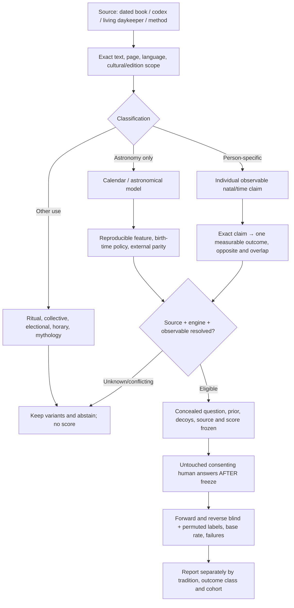
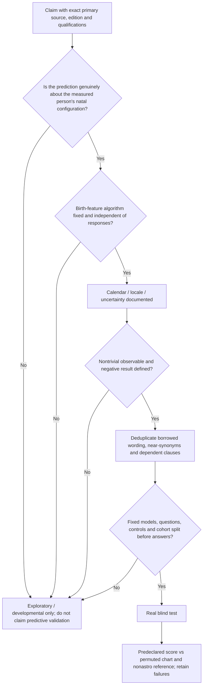

**Latest Gene Keys checkpoint (G37) — every public 64-key Shadow/Gift/Siddhi headline and programming-partner link audited:** [complete public-source study](GENEKEYS_G37_COMPLETE_PUBLIC_64_AND_TESTABLE_CLAIMS_20261025.md), [64 original short publisher records and quoted-anchor provenance](GENEKEYS_G37_OFFICIAL_64_PUBLIC_CATALOG_V1.json), [six official profile-Line communication response styles](GENEKEYS_G37_SIX_LINE_SOURCE_TESTABILITY_V1.json), [durable handoff](GENEKEYS_G37_CONTINUATION_20261025.md), [reproducible local source parser](genekeys_g37_public_source_catalog.py), [optional no-auth public recheck](genekeys_g37_public_recheck_optional.py). **64/64 public short pages** read, **62/64** programming partners align with incumbent 64-wheel, and publisher navigation on **Key6→2 instead of36** and **Key8→8 instead of14** conflicts with their reciprocal pages. The original four source-conditional/qualitative natal-key leads **4,7,27,61** and six official responds-best-to Line styles are distinguished from analyst operationalization: no frozen outcome measurement, no statistical effect, no full 64 paid chapters, no completed official Free Profile parity, **0 real people**, 0 production or active participant-session changes. G37 **22/22 focused**, G35+G36+G37 **59/59**, inherited Hellenistic **367/367** source/engineering tests passed; 426 combined research checks, **not human predictive validations**.

**Latest Gene Keys checkpoint (G36):** [official source meaning audit](GENEKEYS_G36_SOURCE_MEANING_AND_88_DEGREE_PARITY_BOUNDARY_20261025.md), [seven official key meanings and partners](GENEKEYS_G36_PRIMARY_INTERPRETIVE_AND_PROFILE_ACCESS_AUDIT_V1.json), [six synthetic prenatal sphere sensitivities](GENEKEYS_G36_PRENATAL_SPHERE_SENSITIVITY_V1.json), [continuation handoff](GENEKEYS_G36_CONTINUATION_20261025.md). The seven official source pages confirm seven programming partners but no specified statistical birth-to-trait rates. The main official public profiler reports construction status; an alternate form does not supply authenticated completed synthetic birth-profile results. Six synthetic profiles comparing exact 88 degree solar arc with naive 88 days differ for 12/36 core Design Gene Key positions and 26/36 Lines. Gene Keys interpretation is not an independent second natal wheel relative to Human Design. No real-person predictions or production changes.

# Living cross-tradition astrology research map

**Gene Keys source audit G35 — new modern Human Design–derived interpretive lane, distinct from Hellenistic research:** [official-source/full crosswalk report](GENEKEYS_G35_OFFICIAL_SOURCE_CROSSWALK_AND_TEST_PLAN_20261025.md), [actual Gene Keys planet-to-11-sphere mapping and no-prediction code](genekeys_g35_source_crosswalk.py), [six synthetic Swiss/HD crosswalks](GENEKEYS_G35_SYNTHETIC_SPHERE_CROSSWALK_V1.json), [official sources and two distinct test questions](GENEKEYS_G35_SOURCE_STATUS_AND_TEST_PLAN_V1.json), [durable G35 handoff](GENEKEYS_G35_CONTINUATION_20261025.md). The Gene Keys Golden Path has **11 core spheres** across Activation/Venus/Pearl with overlap; **3 additional** spheres documented but separated, and all underlying planetary key/line coordinates are an interpretive crosswalk to existing `hdmatch` Human Design geometry rather than statistically independent natal data. **Four public Gene Keys Sun Pulse references match** existing Swiss wheel; however, official help alternates “88°” and “88 days” and these differ materially in six synthetic charts (1–4 changed prenatal key numbers), so **full official Gene Keys website-profile parity is UNVERIFIED**. Shadow/Gift/Siddhi interpretations are contemplative and cannot be counted as person-level predictions absent source-frozen behavior-first mapping. No full copyrighted 64-key essays copied, **0 Gene Keys human predictive validations**, **0 production or root participant-session changes**. **G35 23/23 focused + 367/367 inherited Hellenistic source/engineering tests PASSED; six synthetic profiles byte-identically reproduced.** Original empirical root objective OPEN.

**Latest Hellenistic research checkpoint (C34) — exact synthetic pre-answer freeze/reveal/statistical-score rehearsal, NOT human evidence:** [C34 full report](HELLENISTIC_SOURCE_C34_SYNTHETIC_BLIND_FREEZE_REHEARSAL_20261025.md), [source-only freeze CLI](hellenistic_c34_synthetic_blind_freeze.py), [unmodified artificial pre-answer predictions](HELLENISTIC_C34_SYNTHETIC_PREANSWER_FREEZE_V1.json), [artificial mock outcomes](HELLENISTIC_C34_SYNTHETIC_MOCK_OUTCOMES_V1.json), [month-stratified mock-only score](HELLENISTIC_C34_SYNTHETIC_STRATIFIED_SCORE_V1.json), [separate real-study consent/readiness gates](HELLENISTIC_C34_REAL_STUDY_READINESS_GATES_V1.json), [durable handoff](HELLENISTIC_CONTINUATION_C34_20261025.md). Actually froze entire C33 **366 synthetic UTC-day** cohort, **55** sign-positive, **186** sign-nonpositive and **125** unresolved; generated outcomes separately by seed and mock ID with no source label dependency, then computed a fixed within-birth-month one-sided **1999-permutation** null. Mock risk difference **−0.060107**, mock permutation `p=0.862`: only a null-like software rehearsal, **not** predictive accuracy on humans. Canonical SHA256 packages, exclusive-create refusal and strict source-level rederivation catch hash/source-label/analysis-policy/participant-set tampering. **367/367 historical/source-engineering tests passed (347 inherited+20 C34)**; all real consent, immutable external timestamp, natal chart-time certification and outcomes remain UNSTARTED. No real birth/marriage data, no production scoring changes, root participant-session exclusive lock unchanged.

**Latest Hellenistic research checkpoint (C33) — observed-outcome feasibility, source-literal marriage-count pilot:** [C33 research and decision report](HELLENISTIC_SOURCE_C33_REAL_HUMAN_TEST_FEASIBILITY_20261025.md), [direct Greek Ptolemy/Loeb and archival source register](HELLENISTIC_C33_MARRIAGE_RULE_AND_FEASIBILITY_V1.json), [historically limited natal lunar/solar bicorporeal-sign subrule](hellenistic_c33_ptolemy_marriage_count.py), [366-day synthetic date-only interval classification](HELLENISTIC_C33_UTC_2020_SYNTHETIC_CLASSIFIER_V1.json), [hypothetical two-proportion feasibility calculations](HELLENISTIC_C33_HYPOTHETICAL_POWER_V1.json), [UNREGISTERED blind-study draft](HELLENISTIC_C33_BLINDED_MARRIAGE_COUNT_STUDY_DRAFT_V1.json), [continuation handoff](HELLENISTIC_CONTINUATION_C33_20261025.md). U.S. NARA explicitly lacks detailed battle/engagement participation in personnel files and imposes 62-year post-separation access for archival records; **C30 military campaign claim retained but not recommended as first cohort**. Ptolemy `Tetrabiblos IV.5` original Greek specifies **male-text Moon or female-text Sun in bicorporeal signs {Gemini, Virgo, Sagittarius, Pisces}** among the alternative indications of multiple marriages. Implemented only the **one-way sign condition**, not the competing/overlapping multiform/application clauses; outside signs no claim of one marriage. Using existing strict Swiss Moon file and a declared but not independently century-certified 16°/day motion bound, 366 synthetic 2020 UTC day windows yielded **55 conditionally positive**, **186 conditionally no-positive**, **125 unresolved** (241/366 sign-condition-stable); **these are not real births or predictive accuracy**. Census B12505 measures marriages in aggregate but does not supply chart-linked individual birth instants. No recruitment or preregistration, no natal time inputs from known people, **0 human predictive validations**, root `participant-session-v1` and production unchanged. **347/347 source/engineering tests passed (329 inherited + 18 C33).**

**Latest Hellenistic research checkpoint (C32) — independent IAU 2006/2000A angle and observed Earth-orientation audit:** [research report](HELLENISTIC_SOURCE_C32_INDEPENDENT_IAU_ANGLE_AUDIT_20261025.md), [full 145 synthetic ERFA-vs-Swiss cases](HELLENISTIC_C32_INDEPENDENT_IAU_ANGLE_PARITY_V1.json), [140 observed-IERS-EOP-corrected cases](HELLENISTIC_C32_OBSERVED_IERS_EOP_SENSITIVITY_V1.json), [independent angle source](hellenistic_c32_independent_iau_angle_audit.py), [observed IERS parser/leap-safe comparison](hellenistic_c32_iers_observed_eop.py), [durable continuation](HELLENISTIC_CONTINUATION_C32_20261025.md). Independent SOFA/ERFA `GST06A + OBL06 + NUT06A` plus eastern-horizon math differs from Swiss Asc/MC by **max 0.0311/0.0321 arcseconds** over 145 fixed synthetic points with DUT1=0; **140/145** cases also have recorded pinned IERS 20 C04 UT1−UTC and independent parity **max 0.0312/0.0319 arcseconds**. A historical ~180° reversed Ascendant is strongly explained as a western rather than eastern horizon-root selection, but its original erroneous code is unavailable; no private DOB/geolocation committed. Swiss Placidus/Whole/Equal/Porphyry/Regiomontanus angles are identical for these cases; DST folds/gaps and leap-second-safe IERS `UT1−TAI` interpolation are tested. Actual historical civil-time/geographic provenance, polar-motion reference corrections, fully certified birth-uncertainty envelopes and cohort outcomes **remain open**. **329/329 Hellenistic source/engineering tests pass (308 inherited + 21 C32); 0 human predictive validations, 0 production changes.**

**Latest Hellenistic research checkpoint (C31) — strict astronomy bridge, angular certification still OPEN:** [complete source-critical report](HELLENISTIC_SOURCE_C31_STRICT_EPHEMERIS_ANGLE_BRIDGE_20261025.md), [durable continuation](HELLENISTIC_CONTINUATION_C31_20261025.md), [source-only Moon/Saturn and uncertified angle adapter](hellenistic_c31_expedition_chart_bridge.py), [synthetic pinned-Swiss evidence](HELLENISTIC_C31_SYNTHETIC_STRICT_ASTRONOMY_EVIDENCE_V1.json), and [reproduction script](generate_hellenistic_c31_synthetic_evidence.py). The incumbent fail-closed `SwissEphemerisProvider` was actually called using two SHA256-pinned `.se1` files on **five synthetic dates**; an independently coded **mean sidereal spherical angle** comparator agreed with existing Swiss ASC to max **0.324 arcmin**, MC **0.206 arcmin**, but did **NOT** adjudicate the known Ascendant/MC discrepancy, UT1/EOP, time zones or full birth uncertainty. A closed-interval Lot indicator adapter can give conditional stability across verified angle/body envelopes without treating samples as proof. Human prediction admission stays **FALSE**, real-person tests **0**, production and active participant-session task unchanged. **308/308 historical-source tests PASSED (291 inherited + 17 C31).**

**Latest Hellenistic research checkpoint (C30) — first literal source-based person-life prediction candidate:** [original Greek/Schmidt Book II.19 source audit](HELLENISTIC_SOURCE_C30_DOROTHEUS_EXPEDITION_PERSON_PREDICTION_20261025.md), [source provenance and one-way rule](HELLENISTIC_C30_DOROTHEUS_EXPEDITION_SOURCE_V1.json), [research-only executable Saturn→Moon→Ascendant Lot of Expedition](hellenistic_c30_dorotheus_expedition_lot.py), [unregistered blinded-study design](HELLENISTIC_C30_EXPEDITION_BLIND_TEST_DESIGN_DRAFT_V1.json), [durable continuation](HELLENISTIC_CONTINUATION_C30_20261025.md). A Greek verse quoted by Hephaistio II.19 (from Dorotheus) asserts military campaigning **when the projected Lot falls in Aries, Scorpio, Capricorn, or Aquarius**; no opposite assertion for other signs, and the supplementary Taurus campaigning example is kept as a separately qualified digital textual layer. The chart feature is now deterministic and source-typed, but the ancient term does not map perfectly onto modern deployments and participant-outcome evaluation **has not begun**. Independent astronomical chart-engine parity/uncertainty and pre-answer study freezes remain prerequisite for actual predictions; no production promotion, **0 human validations**. **291/291 source-only tests passed (278 inherited + 13 C30).**

**Latest Hellenistic research checkpoint (C29):** [full documented source-candidate matrix and conclusion](HELLENISTIC_SOURCE_C29_FROZEN_DOCUMENTARY_CANDIDATES_20261024.md), [machine-readable 360-sign/120-trigon snapshot](HELLENISTIC_C29_DOCUMENTARY_VARIANT_MATRIX_V1.json), [separate source-to-human-test boundary](HELLENISTIC_C29_SOURCE_TO_HUMAN_TEST_DISPOSITION_V1.json), [executable research-only matrix](hellenistic_c29_source_candidate_matrix.py), [durable continuation](HELLENISTIC_CONTINUATION_C29_20261024.md). C04/C05/C15/C21/C22/C24/C28 comparison routines and witnesses now reconstruct **360 by-sign cells** and a **120-position by-trigon comparison of multiple variants/witnesses** (NOT predictions of 480 people): Greek narrative day vs Greenbaum day **34/120 differ**; Florence first vs Greek day **104/120**, vs editor day **102/120**; Florence second vs reconstructed night **48/120**, adjacent swap pattern **120/120** provisional/unblinded; older photographed Paulus family **96/120 neither daytime**. The chapter-32 by-trigon method is sect-light only; physical manuscript slots remain sect UNKNOWN, Vienna108 table unphotographed. Direct original-language ch32–33 describes light-of-sect/Ascendant-degree arithmetic, **no source-justified human behavioral outcome is frozen**, no scoring promotions and **0 untouched human validations**. **278/278 historical-source tests passed (262 inherited +16 C29)**; source-data hash stored in JSON. Root owner scientific evaluation remains OPEN.

**Latest Hellenistic research checkpoint (C28) — correcting a cross-codex Kroll catalogue mistake:** [source-critical correction](HELLENISTIC_SOURCE_C28_KROLL_CODEX_IDENTITY_CORRECTION_20261024.md), [exact corrected source registry](HELIODORUS_C28_KROLL_CODEX_IDENTITY_V1.json), [durable handoff](HELLENISTIC_CONTINUATION_C28_20261024.md). Kroll CCAG VI printed pp1–2 describe **Vienna Cod. phil. gr.108** and its **catalogued folio159v trigon-monomoiria table (not photographed)**, whereas printed pp16–27 describe **distinct Cod. phil. gr.115** with its own photographed **folio205v** table. **C27 incorrectly filed Cod.108 f159v under Cod.115 and used Cod.115 photographs to question the table:** that claim is now expressly **SUPERSEDED**, historical C27 evidence retained. No original Cod.108 f159v photo, independently verified planetary glyphs or Boer1962 apparatus; no scoring promotion and **0 human predictive validations**. **262/262 historical-source tests PASSED (254 inherited + 8 C28).**

**Latest Hellenistic research checkpoint (C27):** [original printed 1898+1903 CCAG chapter-boundary audit](HELLENISTIC_SOURCE_C27_CCAG_VIENNA_FLORENCE_CHAPTERS_20261024.md), [verified cataloguing witness](HELIODORUS_C27_CCAG_CHAPTER_BOUNDARIES_V1.json), [durable handoff](HELLENISTIC_CONTINUATION_C27_20261024.md). Direct inspection of both actual published catalogue scans shows **Vienna chap. λδ/34 triplicity monomoiria extends through f205v; chap. λε/35 begins a distinct Ascendant-degree passage**, while **Florence f202v trigon text, f204v monomoiria figure and f205 next Ascendant chapter** are distinguished independently. The Greek captions/next-chapter adjective have **witness-specific exact lexical differences**, and neither manuscript’s day/night planetary slot interpretation is certified. The earlier printed-page-2 Vienna f159v reference was mistakenly assigned to Cod.115; C28 supersedes that claim by identifying a distinct Cod.108 source and an unexamined original photo. New digitized originals authenticated, existing C24 diagnostics/negatives unchanged, **0 human predictive validations, 0 production rules promoted**. **254/254 historical-source regression tests PASSED (246 inherited + 8 C27), 0 human validations.**

**Latest Hellenistic research checkpoint (C26):** [direct original Vienna Greek section rubric](HELLENISTIC_SOURCE_C26_VIENNA_RUBRIC_IDENTIFICATION_20261024.md), [durable continuation](HELLENISTIC_CONTINUATION_C26_20261024.md), [photo-source-qualified evidence](HELIODORUS_C26_VIENNA_RUBRIC_SOURCE_CLASSIFICATION_V1.json). Direct inspection of **Vienna Cod. phil. gr.115 f205r** at its red heading immediately before f205v yields provisional **Κανόνιον τριγωνομοιριῶν**, textually supporting the *subject class* triplicity monomoiriai also found at Florence Plut.28.14. This does **not** establish shared numerical rules, day/night status, Vienna planetary cells (still **0** independently decoded), exact Greek spelling or ancient author attribution. Preserve C25 original unknown state as its earlier historical read. Boer 1962 actual Greek critical apparatus still unread; no predictive evaluation, model promotion or other-tradition modification. **246/246 historical-source tests PASS (238 C25 inherited + 8 C26), human predictive validations 0.**

**Latest Hellenistic research checkpoint (C25):** [direct original Vienna-A manuscript and layout audit](HELLENISTIC_SOURCE_C25_VIENNA_BASE_F205V_20261024.md), [durable continuation](HELLENISTIC_CONTINUATION_C25_20261024.md), [original-IIIF-photo evidence and provisional Greek numbered pairs](HELIODORUS_C25_VIENNA_A_F205V_SOURCE_LAYOUT_V1.json), [strict structural, no-planet-imputation comparator](heliodorus_c25_vienna_layout_audit.py). Located Vienna ÖNB **Cod. phil. gr.115 / Vindobonensis A** **folio205v**, official public IIIF canvas418 (125 nearby pages actually inspected, 468 total); older base witness of Boer's 1962 attributed commentary edition. **Unlike Florence C24's two planet assignments per same degree**, Vienna's red-ruled table appears to arrange **ordinal numbers 1–15 and 16–30 side by side** within four sign-group columns, and includes a separate Aries-marked panel of unknown function. Five observed number pairs are registered, but **zero degree-specific Vienna planetary ruler readings** are admitted: the exact Greek table heading and whether it is even the same monomoiria scheme require philological verification. Catalogue dating disagrees (ÖNB 1200/1241 eclipse note vs Pinakes twelfth-century estimate) and remains OPEN. Older C22–C24 source conflicts untouched; ****238/238 historical-source tests passed; 0 human predictive validations, no production model promotion**.

**Previous Hellenistic research checkpoint (C24):** [source-critical complete commentary figure report](HELLENISTIC_SOURCE_C24_FLORENCE_COMPLETE_PAIR_COLLATION_20261024.md), [durable continuation](HELLENISTIC_CONTINUATION_C24_20261024.md), [Stage A photo candidate readings](PAULUS_C24_COMMENTARY_120_FIRST_80_SECOND_SOURCE_V1.json), [Stage B complete second slot](PAULUS_C24_COMMENTARY_FULL_SECOND_120_V1.json), and [research-only full 240 source comparator](paulus_c24_complete_240_source_comparison.py). Florence commentary **Plut.28.14, f204v** now has **240 provisional planetary glyph annotations** (120 first/120 second), normalised against the original photographed Greek degrees in two preserved stages: the first 120 appear as **sevenfold repeated lists that differ by triplicity** (C05 narrative day agreement **104/120**, C04 Greenbaum D **102/120**, older C15 Paulus diagram **20/120**); the second 120 appear to be **adjacent-degree pairwise exchanges** of the first list (**120/120** source-annotation consistency) but agree with the independent C05 night narrative only **48/120**. These are **nonblind photo-candidate readings and source-history diagnostics, NOT ancient authorial rulings, independent palaeography or predictive validity**. Exact day/night Greek abbreviations and Boer 1962 original apparatus remain unverified; no production scoring or 16-tradition map mechanism changed; **228/228 historical-source tests PASSED; 0 human predictive validations**.

**Previous Hellenistic research checkpoint (C23):** [source report and direct Greek manuscript find](HELLENISTIC_SOURCE_C23_COMMENTARY_GREEK_CANON_20261024.md), [durable handoff](HELLENISTIC_CONTINUATION_C23_20261024.md), [photo hash and first-eight reading evidence](PAULUS_C23_FLORENCE_COMMENTARY_204V_FIRST_EIGHT_V1.json), and [bounded source-only comparer](paulus_c23_commentary_first_eight.py). **Florence BML Plut.28.14, folio 204v**, a *different* fourteenth-century Greek Heliodorus/Paulus commentary manuscript, contains a red-titled four-triplicity, 30-degree **canon of trigon monomoiriai** with two illustrated planetary slots per degree. The manuscript and adjacent f204r/f205r were personally viewed through official IIIF (72 folio images sampled), and the first **eight first-slot** positions of each trigon were provisionally transcribed; full table and definitive day/night markers remain uncollated. These 32 source candidates agree with **C05 day narrative 28/32, C04 printed Greenbaum D 27/32, previously photographed Paulus family 16/32**. Among nine early disputed C04/C05 cells, the commentary's air degrees 3–6 favor Greenbaum while its water degrees 1–4,8 favor the Greek narrative; **Cancer degree 8 Venus** is still distinct from the Paulus photographed family's Mercury and Greenbaum's corrected Mars. All readings are nonblind, unpromoted and source-typed; **206/206 historical-source tests PASSED; 0 human predictive validations; production and cross-tradition scorer unchanged**. Boer original Greek 1958/1962 critical apparatus still open.

**Previous Hellenistic research checkpoint (C22):** [complete 120-cell documentary reconciliation](HELLENISTIC_SOURCE_C22_FULL_120_RECONCILIATION_20261024.md), [durable handoff](HELLENISTIC_CONTINUATION_C22_20261024.md), [source and evidence boundaries](PAULUS_C22_COMPLETE_120_SOURCE_COMPARISON_PROVENANCE_V1.json), and [deterministic source comparison](paulus_c22_120cell_source_comparison.py). The old **34/120** counts disagreements **between C04 Greenbaum edited daytime and C05 Greek sevenfold narrative rules**; C22 measures each against the provisional photographed manuscript family for the **full 120**: **12 cells match both, 11 narrative only, 1 Greenbaum only, 96 neither**. Against this family: **23/120 narrative day, 13/120 printed D, 13/120 narrative night diagnostic**. These source rates are **not human predictive accuracy**. The local Greenbaum translation (printed pp66–70) directly confirms editorial corrections and a conflicting Olympiodoran Cancer d8 scholion; **actual Boer 1958/1962 Greek critical apparatus remains unread**. Manuscript transcriptions were not blind, and genealogical independence/sect rubric are unverified. **194/194 historical-source tests passed; production scorer and other traditions unchanged; human predictive validations 0.**

**Previous Hellenistic research checkpoint (C21):** [direct Greek clause source report](HELLENISTIC_SOURCE_C21_PAULUS_GREEK_TEXT_SCOPE_20261024.md), [durable continuation](HELLENISTIC_CONTINUATION_C21_20261024.md), [short Greek source/hash registry](PAULUS_C21_GREEK_SECT_LIGHT_CLAUSES_V1.json), [research-only sect-light adapter](paulus_c21_luminary_scope.py) and [12 new source tests](test_hellenistic_c21_greek_sect_light.py). Greek Paulus *Eisagogika* chapters **5,32,33** directly checked from modern Eulogikon Greek text: **ch5** by-sign ruler counts remaining arcminutes in ordinal degree; **ch32** by-trigon rule expressly uses the **light of sect**, skips duplicate planet allocation and distinguishes day/night; **ch33** discusses several alternative Ascendant-determination methods. The online textual rendering lacks the original 30×4 per-degree diagram values, so earlier physical Munich/Florence/Vatican manuscript values and the **34/120** C04/C05 conflicts remain genuinely unresolved. Greek direct text does NOT certify Boer's 1958 printed apparatus, nor the precise Berlin Libra Ascendant. **182/182 historical-source tests passed, 0 real-human predictive validations, no production scorer or cross-tradition map changes.**

**Previous Hellenistic research checkpoint (C20):** [source report](HELLENISTIC_SOURCE_C20_BERLIN_FOUR_CANDIDATES_20261024.md), [durable handoff](HELLENISTIC_CONTINUATION_C20_20261024.md), [four-candidate evidence](BERLIN_C20_MOON_LIBRA_CANDIDATES_V1.json), [source-only calculator](berlin_c20_conditional_monomoiria.py) and [regressions](test_hellenistic_c20_berlin_candidates.py). Zellmann-Rohrer 2024 p296's partly restored Berlin **P. Berol. 21347** Moon monomoiria restricts the missing Libra completed degree to **2,9,16,23**; frozen C04 by-sign Chaldean computation independently reproduces all four. The Egyptian terms of Ptolemy place these under **Saturn, Mercury, Jupiter, Venus**, respectively. **Libra 2°35′ is the editor's conditional favorite, NOT a directly preserved exact longitude**. Source page accessed as search-indexed text, not full PDF. **170/170 historical-source tests PASSED**, 0 human predictive validations, no scoring change, no modification of earlier Oxford papyrus 1/3 results or other traditions.

**Previous Hellenistic research checkpoint (C19):** [durable continuation](HELLENISTIC_CONTINUATION_C19_20261024.md), [Berlin second-century source report](HELLENISTIC_SOURCE_C19_BERLIN_21347_20261024.md), [photo metadata and editorial-readings register](BERLIN_C19_P_BEROL_21347_SOURCE_WITNESS_V1.json), and [source-only tests](test_hellenistic_c19_berlin_21347.py). **P. Berol. 21347** (separate from 319 CE P. Berl. 9825) is now authenticated against Berlin's original image/metadata; full recto viewed, versos and XML downloaded. Zellmann-Rohrer 2024 pp291 and 297 indexes support **Libra night-trigon Mercury** and bracket-restored **Moon monomoiria** in this second-century horoscope, prior to Paulus's 378 CE treatise. These are **scholarly restorations** rather than fully independently re-read Greek; no exact natal longitude or new source formula calculation is claimed. Oxford P.Oxy.4277's previous 1/3 with two negatives remains intact. **160/160 historical-source tests passed; 0 human predictive validations; no production promotion.**

**Previous Hellenistic research checkpoint (C18):** [research](HELLENISTIC_SOURCE_C18_ORDINAL_PARITY_AND_CHRONOLOGY_20261024.md), [handoff](HELLENISTIC_CONTINUATION_C18_20261024.md), [data](P_OXY_C18_ORDINAL_PARITY_AND_CHRONOLOGY_V1.json). Chronology and Tolsa-2017 indexing reconciled; 150 source tests pass, 0 human validations.

**Previous Hellenistic research checkpoint (C17):** [reproducible continuation](HELLENISTIC_CONTINUATION_C17_20261023.md), [exact original P.Oxy. 4277 Oxford photograph report](HELLENISTIC_SOURCE_C17_P_OXY_4277_ORIGINAL_PHOTO_AUTHENTICATION_20261023.md), [Oxford item and two original-JPEG SHA256/MD5 evidence records](P_OXY_C17_OXFORD_ORIGINAL_IMAGE_EVIDENCE_V1.json), [fail-closed original-photo verifier and source-only comparer](poxy4277_original_image_c17.py), and [12 C17 tests](test_hellenistic_c17_poxy_4277_primary_image.py). **Original P.Oxy. LXI 4277 official Oxford image access is now VERIFIED**, Oxford item 21178150/DOI 10.25446/oxford.21178150.v1, two downloaded photos **9,361,845 bytes (3660×2632)** and **192,831 bytes (567×343)**, each with verified original publisher MD5 and local SHA-256, inspected visually. This supersedes prior *image-unavailable* statuses while preserving C05's honest historical state. The papyrus's three C05 monomoiria labels **were not independently re-deciphered glyph-by-glyph in C17**; old source-calculation record **1/3 matching, 2 negative**. **145/145 historical-source tests pass; zero human predictive validations**; no production model rule changed. Copyrighted source photos remain **outside Git**; existing cross-tradition map architecture remains unchanged.

**Previous Hellenistic research checkpoint (C16):** [durable continuation](HELLENISTIC_CONTINUATION_C16_20261023.md), [source-critical Boer 1958 editorial preface analysis](HELLENISTIC_SOURCE_C16_BOER_EDITORIAL_ARCHETYPE_20261023.md), [editorial/provenance registry](PAULUS_C16_BOER_1958_PREFACE_GENEALOGY_V1.json), and [editorial-vs-photo comparison](paulus_boer_preface_lineage_c16.py). A publicly accessible, noisy **OCR preview of Boer's own 1958 Teubner preface** establishes that the editor lists all three photographed Paulus manuscripts, and **conjectures probable descent from one already-mutilated archetype**. That is a scholarly *hypothesis*, not a verified tree, and C15's 120/120 + 119/119 physical-photo matches do **not** become three independent ancient attestations. Boer treats **Z = Paris gr.2506** as a relatively useful recension and **Y = Paris gr.2425** as another valuable older-text lead. Z's dating differs between Boer (early fourteenth century) and the C15 catalogue (thirteenth century): unresolved. Greek chapter-32 *printed apparatus* was **not** visually read, and no model rule accepted. **133/133 historical-source tests passed; 0 human predictive validations**; cross-tradition map/scoring unchanged.

**Previous Hellenistic research checkpoint (C15):** [durable recovery handoff](HELLENISTIC_CONTINUATION_C15_20261023.md), [Vatican–Florence–Munich photographed-source investigation](HELLENISTIC_SOURCE_C15_THREE_PAULUS_MANUSCRIPTS_20261023.md), [120-value Vatican source witness](PAULUS_C15_VATICAN_120_POSITION_SOURCE_WITNESS_V1.json), [cross-manuscript comparison](paulus_c15_three_manuscript_comparison.py), and [12 new tests](test_hellenistic_c15_vatican_third_witness.py). Vatican **Vat. gr. 1444** (1542), photographed digital opening **0202**, independently registers **120/120** glyphs agreeing with earlier Florence and **119/119 readable** Munich positions; Munich earth degree 28 remains **unread** while Florence and Vatican read **Mars**. All three physical codices preserve water degree 9–30 phase and 25 naïve 8-fold counterexamples (3 earth + 22 water). Of the frozen earlier **34 C04/C05 diurnal narrative-vs-printed table disagreements**, source labels are **11 narrative only, 1 corrected printed only, 22 neither**. No proof of independent copy lineage or original ancient author algorithm, **122/122 historical-source tests pass**, **0 human predictive validations**, no production or cross-tradition scoring changes. Boer 1958/1962 Greek apparatus and P.Oxy. 4277 original photo still open.

**Previous Hellenistic research checkpoint (C14):** [durable handoff](HELLENISTIC_CONTINUATION_C14_20261023.md), [Florence 14th-century versus Munich 16th-century original-table study](HELLENISTIC_SOURCE_C14_FLORENCE_MUNICH_MANUSCRIPT_COMPARISON_20261023.md), [full Florence visual witness](PAULUS_C14_FLORENCE_120_POSITION_ORIGINAL_WITNESS_V1.json), and [two-photo calculation comparator](paulus_florence_munich_comparison_c14.py). Florence Plut.28.7 folio 168v has all **120 provisional glyphs**; it agrees with **119/119** Munich cells having a readable source value, with Munich earth degree 28 still unknown and separate Florence earth degree 28 visually reading **Mars**. Both photographs retain the anomalous water shift and earth ending; **25 of Florence's 120 positions fail naïve eight-slot repetition**. Frozen historical Paulus-C05/Greenbaum disputed 34 cells: **11 narrative only, 1 corrected print only, 22 neither**. These are historical textual readings, not independent ancient authors or real-human validations. **Human validations zero, production scorer and 16-tradition map unchanged.**

**Previous Hellenistic research checkpoint (C13):** [durable continuation](HELLENISTIC_CONTINUATION_C13_20261023.md), [complete manuscript page visual collation](HELLENISTIC_SOURCE_C13_MUNICH_120_IMAGE_COLLATION_20261023.md), [120-position source register](PAULUS_C13_MUNICH_120_POSITION_IMAGE_TRANSCRIPTION_V1.json), and [frozen comparison code](paulus_munich_full_c13.py). Original BSB Cod. graec. 170 manuscript p65 now has **119/120 provisionally identified planetary glyphs** (earth degree 28 unresolved), **98/98 historical-source checks PASS**, and **0 real-human predictive validations**. Repeating the first eight positions fails at **water degrees 9–30** and earth 29–30; among all **34** formerly disputed Paulus day-canon cells, this one manuscript agrees **11 with the C05 narrative, 1 with Greenbaum corrected canon, 22 with neither**. These are historical textual comparisons only. No production rule promotion, biography fitting, cross-tradition map mutation or Kindle extraction.

**Previous Hellenistic research checkpoint (C12):** [continuation](HELLENISTIC_CONTINUATION_C12_20261023.md), [Munich manuscript source report](HELLENISTIC_SOURCE_C12_MUNICH_FIRST_OCTET_20261023.md), [first 32 handwritten glyph readings](PAULUS_C12_MUNICH_FIRST_OCTET_SOURCE_WITNESS_V1.json) and [strict source-only comparison module](paulus_munich_first_octet_c12.py). The four manuscript columns group **the four triplicities**, not four individual zodiac signs. All four first-eight degree sequences include **Venus twice**, an unskipped eight-slot pattern; this cannot silently replace either sevenfold method. Of the 34 earlier Paulus–Greenbaum discrepancies, **nine** occur in the inspected first octet: **eight align with the narrative** and **water degree 8 aligns with neither**; remaining 25 not individually read. **86/86 historical-source tests pass; 0 human predictive validations; no production model promotion or Kindle extraction.**

**Previous Hellenistic research checkpoint (C11):** [self-contained continuation](HELLENISTIC_CONTINUATION_C11_20261023.md), [direct Greek source/BSB manuscript report](HELLENISTIC_SOURCE_C11_GREEK_RECENSIONS_MUNICH_MS_20261023.md) and [cross-edition witness register](HEPHAISTIO_C11_MAIN_EPITOME_AND_MUNICH_MANUSCRIPT_WITNESS_V1.json). **77/77 historical-source checks pass, 0 human predictive validations.** C11 corrects false-green C10 Epitome Sun→Sun 130 to **83** (Sun-row sum **531**, not 578); Venus→Sun is 36 in both recensions; an earlier main Greek 35 attribution confused opposite parent/recipient direction. Direct source research discovered BSB Cod. graec. 170 handwritten p65's authentic four-column Paulus monomoiria table; day/night classification and 120-cell collation remain unresolved, so prior **34/120** disagreements are **not yet adjudicated**. Existing cross-tradition map/scorer untouched.

**Previous Hellenistic research checkpoint (C10):** [Continuation handoff](HELLENISTIC_CONTINUATION_C10_20261023.md), [seven-parent §37 printed-Greek audit](HELLENISTIC_SOURCE_C10_IV37_SEVEN_PARENT_GREEK_AUDIT_20261023.md), and [machine-readable uncertainty register](HEPHAISTIO_C10_EPITOME_IV37_SOURCE_QUESTION_REGISTER_V1.json). **67/67 historical-source tests pass**, with **0 human predictive validations**. Mars→Jupiter visually prefers 52 but 42 remains a candidate until independent collation; Moon→Sun 115/145 remains ambiguous. Other §37 printed-parent rows exhibit unrepaired discrepancies. All earlier C08/C09 evidence, the existing cross-tradition map, and the production scorer are preserved unchanged.

**Previous Hellenistic research checkpoint (C09):** [Continuation handoff](HELLENISTIC_CONTINUATION_C09_20261023.md), [source comparison and open variants](HELLENISTIC_SOURCE_C09_COMPLETE_FINE_ROWS_AND_OPEN_GLYPHS_20261023.md), [seven-parent source witness](HEPHAISTIO_C09_FULL_FINE_PERIOD_AND_OPEN_GLYPHS_V1.json). Pingree Epitome IV §44's seven 365-day finer allocations total **366**: Saturn +1, Sun +1, Venus +1, Mercury +1, Moon −3; Jupiter and Mars match. §37 remaining Greek glyphs and Paulus 34/120 monomoiria cells are unresolved. **58/58 historical-source tests pass; 0 human predictive validations; no production promotion.** The source-independent cross-tradition maps remain unchanged.

**Previous Hellenistic research checkpoint (C08):** [Self-contained continuation handoff](HELLENISTIC_CONTINUATION_C08_20261023.md), [corrected original-source comparison](HELLENISTIC_SOURCE_C08_CORRUPT_EPITOME_AND_RECONSTRUCTION_20261023.md) and [literal-versus-derived numerical register](HEPHAISTIO_C08_LITERAL_VS_DERIVED_SUBPERIOD_WITNESS_V1.json). **49/49 source-only tests passed** after source transcription was corrected; **0** human predictive validations. No main scorer promotion or Kindle extraction.

**C08 source correction:** The previous C07 claim that Epitome IV directly prints Saturn→Mercury 140 was false; the enlarged critical edition p240 reads **40**, while its described approximation yields **140**. Fine allocations of the 365-day method also show Venus **22 in the header vs 23 in the detailed heading/children**. [C08 report](HELLENISTIC_SOURCE_C08_CORRUPT_EPITOME_AND_RECONSTRUCTION_20261023.md) and [machine witness](HEPHAISTIO_C08_LITERAL_VS_DERIVED_SUBPERIOD_WITNESS_V1.json) supersede those C07 literal transcription claims without changing the validated source-only research objective.

**23 October C07 source reading:** [Hephaistio's explicit five-day adjustment and manuscript P/P² apparatus](HELLENISTIC_SOURCE_C07_FIVEDAY_CALENDAR_MANUSCRIPTS_20261023.md), [exact 360-vs-365 monthly comparison](HEPHAISTIO_C07_FIVEDAY_MANUSCRIPT_AND_CALENDAR_V1.json) and [five C07 arithmetic/text tests](test_hellenistic_c07_fiveday.py). **C07 historical-source tests formerly 45/45; C08 corrects their mistaken literal-source assumption** from fresh GitHub reads. This corrects the older claim that there was no explicit five-day evidence in Hephaistio: Book II.29 *does* name the five-day period, and P² reinforces it; the separate Book II.36 52/57 question remains unresolved. Source reconstruction ≠ empirical predictive validation (0 humans). The [Epitome IV source register](HEPHAISTIO_C07_EPITOME_IV_INDEPENDENT_RECENSION_V1.json) distinguishes **Epitome IV's corrupt printed Saturn→Mercury 40** from **140 derived by its sevenfold approximation**, alongside the explicit five-day instruction and an explicitly reckoned 365-day year, while the main Greek recension prints 150 and a separate 360-day primary allocation.

**23 October C06 verified-source upgrade:** [Critical Greek Hephaistio timing apparatus, Paulus textual caution and separate Valens–papyrus zodiacal-place reading](HELLENISTIC_SOURCE_C06_PINGREE_APPARATUS_AND_ZODIACAL_PLACES_20261023.md); [numerical Greek critical-edition witness](HEPHAISTIO_C06_PINGREE_CRITICAL_WITNESS_V1.json); [exact documented place attestations](valens_zodiacal_place_c06.py); [C06 continuation checkpoint](HELLENISTIC_CONTINUATION_C06_20261023.md). Direct inspection of Pingree 1973 ch29/36 preserves 150 vs later Valens 140, and the editorial suggestion `νβ desid.` for finer Mercury 52 vs printed 57. This does not prove a corrected calendar, independent ancient manuscript, or human predictive success. Freshly downloaded, isolated **C02–C06 source tests: 36/36 PASS**. This is arithmetic/provenance verification only, with **0** untouched human predictive validations.

**23 October latest Hellenistic C05 research:** [Greek Paulus nocturnal triplicity reconstruction, 34/120 editorial table conflicts and second papyrus with 1/3 historical arithmetic agreement](HELLENISTIC_SOURCE_C05_NIGHT_AND_SECOND_PAPYRUS_20261023.md); [machine-readable provenance and mismatches](HELLENISTIC_C05_SOURCE_VARIANTS_V1.json), [day/night source comparison code](paulus_trigon_narrative_c05.py) and [independent papyrus audit](oxy4277_monomoiria_audit_c05.py). The [C05 continuation checkpoint](HELLENISTIC_CONTINUATION_C05_20261023.md) supersedes only earlier future-work instructions. **31/31 source tests pass from a fresh isolated GitHub retrieval; human validation remains 0.**

**C04 recovery checkpoint:** [Exact reading progress, Greek/English source corrections, 319 CE historical parity and 22/22 test receipt](HELLENISTIC_CONTINUATION_C04_20261023.md). This is an earlier Western/Hellenistic source-reading resume point; older C01–C03 checkpoints remain historical rather than being overwritten.

**23 October C04 source reading:** [Greek Hephaistio II, Paulus chapters 32–37 and original 319 CE papyrus reconstruction](HELLENISTIC_SOURCE_C04_GREEK_PAULUS_PAPYRUS_20261023.md); [source-split Greek 360/365 versus English 375 numeric table](HEPHAISTIO_C04_GREEK_ENGLISH_NUMERIC_VARIANTS_V1.json); [separate source-to-test candidate map](HELLENISTIC_C04_SOURCE_TO_TEST_CANDIDATES_V1.json). [Paulus by-trigon](paulus_monomoiria_source_c04.py) and [by-sign papyrus checks](paulus_bysign_papyrus_c04.py) are deliberately different computations; 6/7 historical scribal entries reproduced with explicit Mercury failure, **no prospective human predictive validation**. Fresh reproducible test suite: **22/22 passed**.

**23 October continuation checkpoint C03:** [exact source pages, corrected acquisition status, 9/9 verification and next reading sequence](HELLENISTIC_CONTINUATION_C03_20261023.md). The Hellenistic corpus remains source-only and research-incomplete; old C01/C02 handoffs are now subordinate to C03 corrections.

**23 October C03 source-integrity correction:** [Paulus, Hephaistio I, Rhetorius scans and three competing daily rates](HELLENISTIC_SOURCE_INTEGRITY_C03_20261023.md); [four source witnesses and explicit missing-page statuses](HELLENISTIC_SOURCE_C03_VARIANTS_V1.json); [neutral exact-fraction rate comparison](hellenistic_daily_sign_variants.py) with [5/5 passing tests](test_hellenistic_daily_sign_variants.py). Rhetorius printed p140 is absent, and the Paulus PDF contains Paulus only through printed p77, **not** the Olympiodorus commentary in the contents. No model promotion or human test.

**23 October Hellenistic source comparison:** [C01: original-source career, dignity and synastry variants](HELLENISTIC_SOURCE_COMPARISON_C01_20261023.md); [C02: 129-month period source comparison, calendar discrepancies and Saturn→Mars opposite forecasts](HEPHAISTIO_II_TIMELORD_C02_20261023.md). Read the [unmodified numerical source witness](HEPHAISTIO_II_TIMELORD_NUMERICAL_WITNESS_V1.json) and [six quarantined source-to-test candidates](HELLENISTIC_C01_C02_SOURCE_CANDIDATES_V1.json) before any implementation. [Four arithmetic witness tests](test_hellenistic_period_witness.py) passed from a clean download. These do not validate human prediction; disputed variants are **not scored or promoted**.

**23 October source-study recovery checkpoint:** [C01/C02 exact work completed, source tests and next reading](HELLENISTIC_CONTINUATION_C01_C02_20261023.md); do not repeat completed comparisons or promote variants to predictions.\n\n**22 October source-reading update:** [Hephaistio II's page-anchored profession and dignity variant witnesses](HEPHAISTIO_II_FIRST_SOURCE_COMPARISON_20261022.md) are source-only and not scored or promoted.
**22 October local update:** [12-file acquired-book inventory, verified hashes, al-Bīrūnī misattribution, and revised reading order](LOCAL_ACQUISITION_RECONCILIATION_20261022.md). This supersedes the earlier Drive-only ‘missing book’ statuses while preserving the initial audit's source recommendations.

## Hellenistic and other missing-book acquisition audit (22 October 2026)

The verified title-by-title [Hellenistic, Arabic/Persian, Babylonian and cross-tradition acquisition audit](ASTROLOGY_MISSING_BOOKS_AND_EDITIONS_20261022.md) distinguishes existing copies, legal free reference scans and genuinely missing source editions; it specifically notes that owned *Persian Nativities IV* replaces the partial *III*. It changes no prediction score or model.

22 October 2026 — **source-controlled research overview; no new validated predictive model**

## Current reconciled owner guide and Maya source status (22 October)

Start with [**which Maya books you already own, what else matters, and whether our research map is doing the right job**](OWNER_GUIDE_MAYA_BOOKS_SYSTEMS_AND_RESEARCH_MAP_20261022.md). This owner-readable guide supersedes the earlier book-status conclusion that Maya source reading had not begun; accepted **later separate Maya source-reader branches** have now verified actual user-owned books, one living Indigenous daykeeper publication, and two original 1892 printed facsimile pages of the Dresden Venus material.

**The *one* canonical candidate workflow diagram remains [WORKFLOW.mmd](WORKFLOW.mmd)**; source-to-human evidence gates remain [SOURCE_TO_TEST_GATES.mmd](SOURCE_TO_TEST_GATES.mmd), and shared historical ancestry appears in [TRADITION_DEPENDENCIES.mmd](TRADITION_DEPENDENCIES.mmd). Do not create another competing diagram. The current descriptive inventory is [TRADITION_COVERAGE_RECONCILED_V2.json](TRADITION_COVERAGE_RECONCILED_V2.json), retaining the immutable original [V1](TRADITION_COVERAGE_V1.json); [RECONCILED_SOURCE_TO_TEST_EVIDENCE_V1.json](RECONCILED_SOURCE_TO_TEST_EVIDENCE_V1.json) preserves exact source-branch ancestry, file SHA and explicit unset test gates. [reconcile_accepted_maya_lanes.py](reconcile_accepted_maya_lanes.py) reproduces the registry from the accepted source-reader records without changing original evidence.

Integration is **research-source-only on its own branch**: 16 historical/modern family classes; owner actually possesses 4 nonfiction Maya research books; the living daykeeper source has 20 name correspondences and 7 *unfrozen* candidate personal meanings; the printed Dresden facsimiles of p24 and p46 were visually inspected but **zero original glyph values independently deciphered**. Existing six HD survey areas plus 14 non-HD claim categories are *domain labels*, not scored or validated chart mappings. Lowland GMT 584283/584285 date conversion does **not** establish the epoch or local day boundary for living K'iche' calendars, and neither Dresden Venus astronomy nor modern Dreamspell can be silently promoted into ancient natal-personality readings. Human independently blinded validations: **0**; runtime astro rule promotions: **0**.

The source-to-observable-to-test workflow has real **HD normative methods** on default main, but its cross-tradition Maya/Chinese/Western/Jyotish/Tibetan claim comparisons are not integrated production algorithms. All remaining unverified steps are open, especially true source predicates, independently calculated chart/time policy, concealed participant questions, decoys and baseline, pre-answer prediction freeze, actual consenting untouched humans and separately reported misses.

**Owner outcome:** Find out whether independently calculated birth-derived astrological/HD patterns predict *unseen people's specific responses or future events* better than matched charts, date/control hypotheses and nonastrology baselines, while preserving failed predictions. That empirical outcome remains **OPEN; 0 validated blinded real-human predictions** in the audited tradition tracks.

## Existing map versus missing map

The repository already has a **Human Design-only** [architecture diagram](../../ARCHITECTURE.md), [V2 source-to-behavior mapping protocol](../../reference/core/MAPPING_V2_EVIDENCE_PROTOCOL.md), V4.3 score/reliability policy, questionnaire bank, separate natal/relationship tests, and many *per-tradition* source indexes and domain crosswalks. Those are valuable but **not a single accepted map joining all the schools**. This branch adds that missing *cross-tradition map/index*. It is descriptive, not merged into the production HD scorer and not a replacement for `ARCHITECTURE.md`.

**Canonical map sources:** [overview/workflow](WORKFLOW.mmd), [admission and exclusion gates](SOURCE_TO_TEST_GATES.mmd), [textual lineage links](TRADITION_DEPENDENCIES.mmd), [current reconciled 16-family coverage registry](TRADITION_COVERAGE_RECONCILED_V2.json), [ranked Maya source catalog](MAYA_SOURCE_CATALOG_V1.json), [Maya source first-read / exploratory claim witnesses](MAYA_FIRST_SOURCE_WITNESS_V1.json), [ranked reading plan](MAYA_READING_AND_RESEARCH_PLAN.md), [common source-to-observable claim schema](CLAIM_TRACE_SCHEMA_V1.json), and [one source-only Maya example](CLAIM_TRACE_EXAMPLE_MAYA_E_V1.json). Each arrow is a *desired verified route* with explicit current status, **not a declaration that every transition is already implemented**.

### Overview — where source reading must actually lead

**Important:** A correct chart from the source's own algorithm is an *engineering* achievement; it does not count as an observation of what a person did. A historical horoscope book's retrospective case study is not an untouched prediction. A Sanskrit → Tibetan or Greek → Arabic → Latin transmission is source lineage, not three independent experiments.

### Interpretation and trial gate — where earlier source-heavy work stalled

External provider and third-party calendar disagreement remains an uncertainty set; different-looking methods must not be chosen after an owner's or participant's chart seems to fit a known story. For Maya, 584283 vs 584285 Gregorian/Long Count correlation, highland vs lowland names, day boundary and numeral 1–13 meaning must remain explicit, not silently collapsed.

## What is already happening, and what is still missing?

| Layer | Actual audited status | Next measurable evidence |
|---|---|---|
| Reading original sources | **Very active** Western, Jyotish, Chinese, Tibetan; new Maya source catalog and one contemporary primary practitioner text read | Preserve original paragraph/page and source independence, not just a large quotation count |
| Source-domain coverage | **Partial and fragmented**: individual tradition indexes and some crosswalks exist | A common claim/construct record across traditions with historical dependencies |
| Astronomical/chart calculations | **Partially tested synthetic**: HD Swiss, Chinese lunar/14-star and BaZi JieQi studies; source/clock variants unresolved | A reproducible chart under fixed declared school and time policy; abstain near conflicts |
| Chart → actual personal observable | **Some HD and Zi Wei candidates**, with overlapping terms, flexible clauses and source-critical gaps | Pick a small nontrivial behavioral question; fix effect direction, confounds and source variants BEFORE exposure to answers |
| Blinded scoring system | **Synthetic engineering tests exist**; these check code and null discrimination, not people | Match actual independently calculated chart/decoys, fix baseline and sample-size denominator |
| Prospective real-human studies | **0** documented confirmatory successes in audited source tracks | Freeze and run an untouched consenting cohort; preserve negative results |
| Maya | **Four owner-held research books and two source-pinned Dresden printed facsimile pages; first-read living K’iche’ text with seven unfrozen candidate claims; lowland date-only calculator tested** | Independent living K’iche’ day-count anchor, original glyph source reading and context-specific natal question still missing. No human model accepted |
| Nahua, Babylonian, Hellenistic outside Ptolemy, Arabic/Persian | **Missing source-first tracks** | Add original first-source witnesses only if claims materially improve domain coverage or an independent method |

## Mapping individual domains without pretending they are equivalent

Different traditions often mention the same life domain but **different measurable things**. This table is a planning overlay, not a merged scoring matrix:

| Life domain | Source traditions with original claims | What must be disambiguated |
|---|---|---|
| Travel and relocation | Lilly travels; Chinese Zi Wei Travel; Jyotish overseas/migration passages; K'iche' E/Eb' birth-day disposition | **Actual relocation or sea voyage** versus *liking travel/generosity*, fixed age window, opportunity/resources; no common score until aligned |
| Family, siblings, parenthood | Lilly natal siblings/children; Zi Wei Brothers/Children; Jyotish family clauses; Tibetan family passages | Counts, biological/adoptive/step definitions, source conditions, age/time, base rate; untestable original metaphors excluded |
| Marriage and interpersonal patterns | Lilly, Jyotish, Zi Wei Spouses, Tibetan marriage, some Maya birth-day claims | Marriage occurrence/timing vs satisfaction, partner traits vs self-traits, local cultural cohort opportunities |
| Work, character and status | Lilly natal profession; Jyotish yogas; Zi Wei Career; some K'iche' named-day occupations | Prestige/wealth/occupation vs kindness, prudence, stress behavior; cultural opportunity confounds |
| Illness, lifespan, danger | Multiple historical source traditions | **Not eligible for practical recommendations**; exact historical predictions can be studied methodologically but not asserted as medical or safety truth |
| Timing and collective astronomy | Dresden codex, Tibetan almanacs, Chinese electional, Lilly elections, Babylonian omens | Astronomy/ritual/electional **not** automatically personal birth-chart behavior |

### Required claim record

Every proposed scored claim should eventually contain: `tradition_id`, `edition/source_id`, `page/verse`, `exact_limited_quote_or_paraphrase`, `original_vs_commentator`, `prediction_class`, `chart_algorithm_id`, `clock_policy`, `predictor`, `conditions_and_exceptions`, `effect_and_contrary`, `observable_question_ids`, `base_rates`, `source_dependencies`, `confounds`, `eligibility`, `freeze_hash`, `human_cohort_stage`, `outcome_test_record`. Blank fields indicate **UNRESOLVED**, not zero or a fabricated success.

The [K'iche' daykeeper first-read source witness](MAYA_FIRST_SOURCE_WITNESS_V1.json) deliberately contains seven candidate-only claims. None has a frozen Mayan date-conversion engine, independently sourced numerical-tone contribution, calibrated probability, approved exact survey question or untouched outcome. The historic `E/Eb'` association with travel is not equivalent to a personal forecast of emigration.

## Research priorities and maintenance rule

A research project that reads another 10,000 clauses without demonstrating a reproducible source-to-question test will produce a larger library rather than stronger predictive evidence. Continue source reading in parallel, but require the **next map update to answer a direct scientific question**: which new outcome or chart prediction becomes fixed and falsifiable, and which previous ambiguities or duplicates were resolved?

This project map is a *living visual index over independently accepted source branches*; **no source register was merged or promoted by authoring it**. Update the 16-tradition inventory and diagram together only when a material source family/construct/evidence/test stage changes. Never let an attractive diagram overrule the actual source registry, consent/privacy rules or empirical-score freeze. The ongoing **Human Design** `ARCHITECTURE.md` remains canonical for its runtime, scoring and relationship architecture.
 [C07 complete continuation checkpoint](HELLENISTIC_CONTINUATION_C07_20261023.md) preserves exactly what was read and the next evidence frontier.