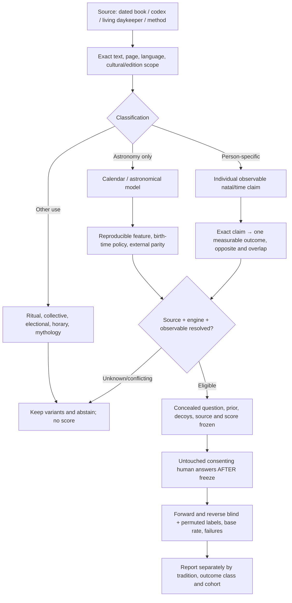
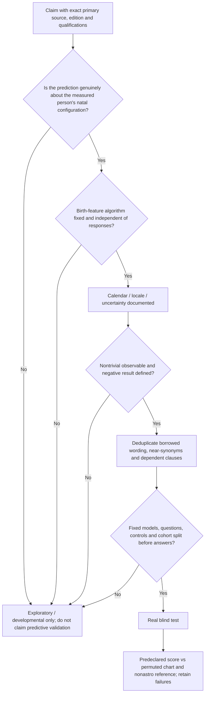

# Living cross-tradition astrology research map

**C04 recovery checkpoint:** [Exact reading progress, Greek/English source corrections, 319 CE historical parity and 22/22 test receipt](HELLENISTIC_CONTINUATION_C04_20261023.md). This is the latest Western/Hellenistic source-reading resume point; older C01–C03 checkpoints remain historical rather than being overwritten.

**23 October C04 source reading:** [Greek Hephaistio II, Paulus chapters 32–37 and original 319 CE papyrus reconstruction](HELLENISTIC_SOURCE_C04_GREEK_PAULUS_PAPYRUS_20261023.md); [source-split Greek 360/365 versus English 375 numeric table](HEPHAISTIO_C04_GREEK_ENGLISH_NUMERIC_VARIANTS_V1.json); [separate source-to-test candidate map](HELLENISTIC_C04_SOURCE_TO_TEST_CANDIDATES_V1.json). [Paulus by-trigon](paulus_monomoiria_source_c04.py) and [by-sign papyrus checks](paulus_bysign_papyrus_c04.py) are deliberately different computations; 6/7 historical scribal entries reproduced with explicit Mercury failure, **no prospective human predictive validation**. Fresh reproducible test suite: **22/22 passed**.

**23 October continuation checkpoint C03:** [exact source pages, corrected acquisition status, 9/9 verification and next reading sequence](HELLENISTIC_CONTINUATION_C03_20261023.md). The Hellenistic corpus remains source-only and research-incomplete; old C01/C02 handoffs are now subordinate to C03 corrections.

**23 October C03 source-integrity correction:** [Paulus, Hephaistio I, Rhetorius scans and three competing daily rates](HELLENISTIC_SOURCE_INTEGRITY_C03_20261023.md); [four source witnesses and explicit missing-page statuses](HELLENISTIC_SOURCE_C03_VARIANTS_V1.json); [neutral exact-fraction rate comparison](hellenistic_daily_sign_variants.py) with [5/5 passing tests](test_hellenistic_daily_sign_variants.py). Rhetorius printed p140 is absent, and the Paulus PDF contains Paulus only through printed p77, **not** the Olympiodorus commentary in the contents. No model promotion or human test.

**23 October Hellenistic source comparison:** [C01: original-source career, dignity and synastry variants](HELLENISTIC_SOURCE_COMPARISON_C01_20261023.md); [C02: 129-month period source comparison, calendar discrepancies and Saturn→Mars opposite forecasts](HEPHAISTIO_II_TIMELORD_C02_20261023.md). Read the [unmodified numerical source witness](HEPHAISTIO_II_TIMELORD_NUMERICAL_WITNESS_V1.json) and [six quarantined source-to-test candidates](HELLENISTIC_C01_C02_SOURCE_CANDIDATES_V1.json) before any implementation. [Four arithmetic witness tests](test_hellenistic_period_witness.py) passed from a clean download. These do not validate human prediction; disputed variants are **not scored or promoted**.

**23 October source-study recovery checkpoint:** [C01/C02 exact work completed, source tests and next reading](HELLENISTIC_CONTINUATION_C01_C02_20261023.md); do not repeat completed comparisons or promote variants to predictions.\n\n**22 October source-reading update:** [Hephaistio II's page-anchored profession and dignity variant witnesses](HEPHAISTIO_II_FIRST_SOURCE_COMPARISON_20261022.md) are source-only and not scored or promoted.
**22 October local update:** [12-file acquired-book inventory, verified hashes, al-Bīrūnī misattribution, and revised reading order](LOCAL_ACQUISITION_RECONCILIATION_20261022.md). This supersedes the earlier Drive-only ‘missing book’ statuses while preserving the initial audit's source recommendations.

## Hellenistic and other missing-book acquisition audit (22 October 2026)

The verified title-by-title [Hellenistic, Arabic/Persian, Babylonian and cross-tradition acquisition audit](ASTROLOGY_MISSING_BOOKS_AND_EDITIONS_20261022.md) distinguishes existing copies, legal free reference scans and genuinely missing source editions; it specifically notes that owned *Persian Nativities IV* replaces the partial *III*. It changes no prediction score or model.

22 October 2026 — **source-controlled research overview; no new validated predictive model**

## Current reconciled owner guide and Maya source status (22 October)

Start with [**which Maya books you already own, what else matters, and whether our research map is doing the right job**](OWNER_GUIDE_MAYA_BOOKS_SYSTEMS_AND_RESEARCH_MAP_20261022.md). This owner-readable guide supersedes the earlier book-status conclusion that Maya source reading had not begun; accepted **later separate Maya source-reader branches** have now verified actual user-owned books, one living Indigenous daykeeper publication, and two original 1892 printed facsimile pages of the Dresden Venus material.

**The *one* canonical candidate workflow diagram remains [WORKFLOW.mmd](WORKFLOW.mmd)**; source-to-human evidence gates remain [SOURCE_TO_TEST_GATES.mmd](SOURCE_TO_TEST_GATES.mmd), and shared historical ancestry appears in [TRADITION_DEPENDENCIES.mmd](TRADITION_DEPENDENCIES.mmd). Do not create another competing diagram. The current descriptive inventory is [TRADITION_COVERAGE_RECONCILED_V2.json](TRADITION_COVERAGE_RECONCILED_V2.json), retaining the immutable original [V1](TRADITION_COVERAGE_V1.json); [RECONCILED_SOURCE_TO_TEST_EVIDENCE_V1.json](RECONCILED_SOURCE_TO_TEST_EVIDENCE_V1.json) preserves exact source-branch ancestry, file SHA and explicit unset test gates. [reconcile_accepted_maya_lanes.py](reconcile_accepted_maya_lanes.py) reproduces the registry from the accepted source-reader records without changing original evidence.

Integration is **research-source-only on its own branch**: 16 historical/modern family classes; owner actually possesses 4 nonfiction Maya research books; the living daykeeper source has 20 name correspondences and 7 *unfrozen* candidate personal meanings; the printed Dresden facsimiles of p24 and p46 were visually inspected but **zero original glyph values independently deciphered**. Existing six HD survey areas plus 14 non-HD claim categories are *domain labels*, not scored or validated chart mappings. Lowland GMT 584283/584285 date conversion does **not** establish the epoch or local day boundary for living K'iche' calendars, and neither Dresden Venus astronomy nor modern Dreamspell can be silently promoted into ancient natal-personality readings. Human independently blinded validations: **0**; runtime astro rule promotions: **0**.

The source-to-observable-to-test workflow has real **HD normative methods** on default main, but its cross-tradition Maya/Chinese/Western/Jyotish/Tibetan claim comparisons are not integrated production algorithms. All remaining unverified steps are open, especially true source predicates, independently calculated chart/time policy, concealed participant questions, decoys and baseline, pre-answer prediction freeze, actual consenting untouched humans and separately reported misses.

**Owner outcome:** Find out whether independently calculated birth-derived astrological/HD patterns predict *unseen people's specific responses or future events* better than matched charts, date/control hypotheses and nonastrology baselines, while preserving failed predictions. That empirical outcome remains **OPEN; 0 validated blinded real-human predictions** in the audited tradition tracks.

## Existing map versus missing map

The repository already has a **Human Design-only** [architecture diagram](../../ARCHITECTURE.md), [V2 source-to-behavior mapping protocol](../../reference/core/MAPPING_V2_EVIDENCE_PROTOCOL.md), V4.3 score/reliability policy, questionnaire bank, separate natal/relationship tests, and many *per-tradition* source indexes and domain crosswalks. Those are valuable but **not a single accepted map joining all the schools**. This branch adds that missing *cross-tradition map/index*. It is descriptive, not merged into the production HD scorer and not a replacement for `ARCHITECTURE.md`.

**Canonical map sources:** [overview/workflow](WORKFLOW.mmd), [admission and exclusion gates](SOURCE_TO_TEST_GATES.mmd), [textual lineage links](TRADITION_DEPENDENCIES.mmd), [current reconciled 16-family coverage registry](TRADITION_COVERAGE_RECONCILED_V2.json), [ranked Maya source catalog](MAYA_SOURCE_CATALOG_V1.json), [Maya source first-read / exploratory claim witnesses](MAYA_FIRST_SOURCE_WITNESS_V1.json), [ranked reading plan](MAYA_READING_AND_RESEARCH_PLAN.md), [common source-to-observable claim schema](CLAIM_TRACE_SCHEMA_V1.json), and [one source-only Maya example](CLAIM_TRACE_EXAMPLE_MAYA_E_V1.json). Each arrow is a *desired verified route* with explicit current status, **not a declaration that every transition is already implemented**.

### Overview — where source reading must actually lead

**Important:** A correct chart from the source's own algorithm is an *engineering* achievement; it does not count as an observation of what a person did. A historical horoscope book's retrospective case study is not an untouched prediction. A Sanskrit → Tibetan or Greek → Arabic → Latin transmission is source lineage, not three independent experiments.

### Interpretation and trial gate — where earlier source-heavy work stalled

External provider and third-party calendar disagreement remains an uncertainty set; different-looking methods must not be chosen after an owner's or participant's chart seems to fit a known story. For Maya, 584283 vs 584285 Gregorian/Long Count correlation, highland vs lowland names, day boundary and numeral 1–13 meaning must remain explicit, not silently collapsed.

## What is already happening, and what is still missing?

| Layer | Actual audited status | Next measurable evidence |
|---|---|---|
| Reading original sources | **Very active** Western, Jyotish, Chinese, Tibetan; new Maya source catalog and one contemporary primary practitioner text read | Preserve original paragraph/page and source independence, not just a large quotation count |
| Source-domain coverage | **Partial and fragmented**: individual tradition indexes and some crosswalks exist | A common claim/construct record across traditions with historical dependencies |
| Astronomical/chart calculations | **Partially tested synthetic**: HD Swiss, Chinese lunar/14-star and BaZi JieQi studies; source/clock variants unresolved | A reproducible chart under fixed declared school and time policy; abstain near conflicts |
| Chart → actual personal observable | **Some HD and Zi Wei candidates**, with overlapping terms, flexible clauses and source-critical gaps | Pick a small nontrivial behavioral question; fix effect direction, confounds and source variants BEFORE exposure to answers |
| Blinded scoring system | **Synthetic engineering tests exist**; these check code and null discrimination, not people | Match actual independently calculated chart/decoys, fix baseline and sample-size denominator |
| Prospective real-human studies | **0** documented confirmatory successes in audited source tracks | Freeze and run an untouched consenting cohort; preserve negative results |
| Maya | **Four owner-held research books and two source-pinned Dresden printed facsimile pages; first-read living K’iche’ text with seven unfrozen candidate claims; lowland date-only calculator tested** | Independent living K’iche’ day-count anchor, original glyph source reading and context-specific natal question still missing. No human model accepted |
| Nahua, Babylonian, Hellenistic outside Ptolemy, Arabic/Persian | **Missing source-first tracks** | Add original first-source witnesses only if claims materially improve domain coverage or an independent method |

## Mapping individual domains without pretending they are equivalent

Different traditions often mention the same life domain but **different measurable things**. This table is a planning overlay, not a merged scoring matrix:

| Life domain | Source traditions with original claims | What must be disambiguated |
|---|---|---|
| Travel and relocation | Lilly travels; Chinese Zi Wei Travel; Jyotish overseas/migration passages; K'iche' E/Eb' birth-day disposition | **Actual relocation or sea voyage** versus *liking travel/generosity*, fixed age window, opportunity/resources; no common score until aligned |
| Family, siblings, parenthood | Lilly natal siblings/children; Zi Wei Brothers/Children; Jyotish family clauses; Tibetan family passages | Counts, biological/adoptive/step definitions, source conditions, age/time, base rate; untestable original metaphors excluded |
| Marriage and interpersonal patterns | Lilly, Jyotish, Zi Wei Spouses, Tibetan marriage, some Maya birth-day claims | Marriage occurrence/timing vs satisfaction, partner traits vs self-traits, local cultural cohort opportunities |
| Work, character and status | Lilly natal profession; Jyotish yogas; Zi Wei Career; some K'iche' named-day occupations | Prestige/wealth/occupation vs kindness, prudence, stress behavior; cultural opportunity confounds |
| Illness, lifespan, danger | Multiple historical source traditions | **Not eligible for practical recommendations**; exact historical predictions can be studied methodologically but not asserted as medical or safety truth |
| Timing and collective astronomy | Dresden codex, Tibetan almanacs, Chinese electional, Lilly elections, Babylonian omens | Astronomy/ritual/electional **not** automatically personal birth-chart behavior |

### Required claim record

Every proposed scored claim should eventually contain: `tradition_id`, `edition/source_id`, `page/verse`, `exact_limited_quote_or_paraphrase`, `original_vs_commentator`, `prediction_class`, `chart_algorithm_id`, `clock_policy`, `predictor`, `conditions_and_exceptions`, `effect_and_contrary`, `observable_question_ids`, `base_rates`, `source_dependencies`, `confounds`, `eligibility`, `freeze_hash`, `human_cohort_stage`, `outcome_test_record`. Blank fields indicate **UNRESOLVED**, not zero or a fabricated success.

The [K'iche' daykeeper first-read source witness](MAYA_FIRST_SOURCE_WITNESS_V1.json) deliberately contains seven candidate-only claims. None has a frozen Mayan date-conversion engine, independently sourced numerical-tone contribution, calibrated probability, approved exact survey question or untouched outcome. The historic `E/Eb'` association with travel is not equivalent to a personal forecast of emigration.

## Research priorities and maintenance rule

A research project that reads another 10,000 clauses without demonstrating a reproducible source-to-question test will produce a larger library rather than stronger predictive evidence. Continue source reading in parallel, but require the **next map update to answer a direct scientific question**: which new outcome or chart prediction becomes fixed and falsifiable, and which previous ambiguities or duplicates were resolved?

This project map is a *living visual index over independently accepted source branches*; **no source register was merged or promoted by authoring it**. Update the 16-tradition inventory and diagram together only when a material source family/construct/evidence/test stage changes. Never let an attractive diagram overrule the actual source registry, consent/privacy rules or empirical-score freeze. The ongoing **Human Design** `ARCHITECTURE.md` remains canonical for its runtime, scoring and relationship architecture.
