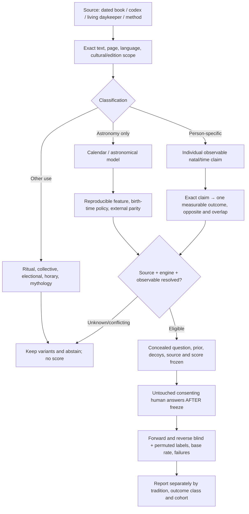
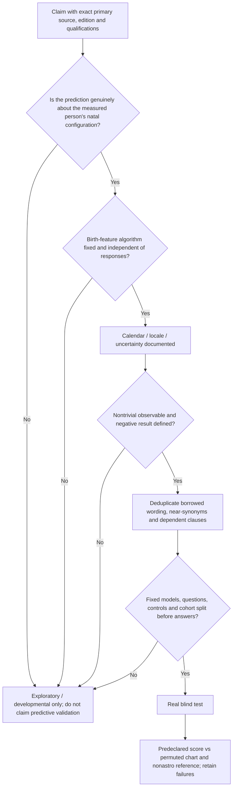

# Living cross-tradition astrology research map
22 October 2026 — **source-controlled research overview; no new validated predictive model**

## 1722 K’iche’ manuscript: historical Julian/Gregorian caution (B06)

[Source-critical correction](MAYA_B06_1722_CIVIL_DATE_STYLE_SOURCE_CONFLICT_20261022.md): the Newberry Library’s description calls the 1722 copy’s Spanish dates **Julian**, whereas the later Guatemala Ministry study treats them as **Gregorian**. The manuscript itself visibly records the labels without deciding that terminology. Our fixed GMT584283 reference matches **30/30 photographed rows when labels are Gregorian**, but **0/30** if the same written 1722–23 dates are interpreted as Julian (+11 actual days). **The historic calendar-style ambiguity remains OPEN**; none of the 52 directly read sacred-day groups is affected, and **0 human predictions** were validated. Tests **113/113**.

## Maya 1722 facsimile full 52-group audit (B05)

[Direct reading of all 52 photographed five-day groups](MAYA_B05_FULL_52_1722_FOLIO_SOURCE_AUDIT_20261022.md) extends the earlier 13 verified groups with [39 more hand-transcribed groups](MAYA_1722_B05_DIRECT_FOLIO_GROUPS_14_TO_52.txt). All **260** numbered day-name combinations occur once, and **107/107** source/algorithm tests pass. K'iche' interpretive prose remains untranslated; **zero human natal predictions validated**.

## Maya 1722 original facsimile first direct collation (22 October, B04)

The [1722 K'iche' manuscript's **actual photographed 1877 copy** is now partly read directly](MAYA_B04_ORIGINAL_1722_FOLIO_COLLATION_AND_5x52_20261022.md): **26/26 original photo SHA checks**, **30 hand-read 1722–1723 Gregorian/sacred-day entries**, **13 observed five-entry AHILABALZIH groups** corresponding to a [pure 5×52 calendar-interval calculation](maya_1722_five_by_52_reference.py). Original 1722 [May 3 = 9 Queh](MAYA_1722_PRIMARY_FACSIMILE_HAND_READ_B04.json) and **1723 May 3 = 10 Ee** align with the existing date-only GMT584283 engine. The 1722 text's 52 mathematical five-name groups should NOT be silently collapsed into a modern 20-personality-sign horoscope; ancient codices and living regional practitioner readings remain separate. The old 2005 filmed-date discrepancy stays **unresolved**. Publisher-authorized 2009 critical edition **opening chapter** and its 20-name Table 1.1 were read, not the full 1722 translation (pp.64–135). **96/96** total local map-source tests pass; **zero** real-human predictive validations.

## Maya original filmed daykeeper conflict and Madrid almanac chapter 6–7 audit (22 October, B03)

[The new dated practitioner discrepancy, the two-day production-date ambiguity and the expanded Madrid/Dresden scholarly date audit](MAYA_B03_NEW_SOURCE_CONFLICTS_AND_MADRID_READING_20261022.md) preserve **Andrés Xiloj's 2005 translated interview statement 7 Tz'i' on the film's purported 12 February date** even though the previously fixed GMT584283 civil-day converter returns 8 B'atz'; [the exact historical source/uncertainty record](MAYA_2005_PRACTITIONER_AND_2019_DATE_DISCREPANCY_V1.json) also records a 2019 May 10 community ceremonial 8 B'atz' report matching GMT584283, plus Barbara and Dennis Tedlock's companion filming over 11–12 February 2005. **No single clock/correlation policy is selected by posthoc fit**. The [Madrid chapter 6/7 reading ledger](MAYA_MADRID_CH6_CH7_READING_AND_DATE_PARITY_B03.json) and [diagnostic source-date comparison](maya_published_day_witness_audit.py) preserve seven interpreted astronomical/Calendar Round date fits and Classic-versus-Mayapán Haab month-label differences **without inferring Maya natal traits**. **86/86** affected source/algorithm tests green, including seven new 1722 historical/yearbearer checks; **0** prospective human predictions, **0** runtime promotions. Earlier accepted 16-family map and historical registries retained unchanged.

The [1722 colonial K'iche' manuscript source trace](MAYA_1722_COLONIAL_KICHE_YEARBEARER_WITNESS_V1.json) additionally locates the original Berendt–Brinton item 58 facsimile and its 2009 scholarly critical edition; the older **3 May 1722 = 9 Kej, 5 K'ayab'** and **40-day separation from Lowland 0 Pop** pass seven dated/source-semantic tests. These 9 government-table rows were computed using GMT584283 by their authors, so this is **reconstructed calendar-source coherence**, not nine newly independent confirmations of living calendar or human behavior.

## Maya sunset-clock and 20-day community source audit (22 October, next research increment)

[Guatemala Ministry of Culture's original Spanish sunset/dawn evidence, 14 day-phase anchors and Momostenango–Zunil 20-day natal-domain discrepancies](MAYA_SUNSET_AND_NATAL_COMMUNITY_AUDIT_20261022.md) are now inspected and mechanically reproduced. The [2016 documentary date-phase witnesses](MAYA_SUNSET_BOUNDARY_SOURCE_WITNESSES_V1.json) support a **bounded, unscored Cholq’ij-after-sunset variant** via [date-only sensitivity helper](maya_sunset_boundary_sensitivity.py) while **Ab’/Haab’ dawn rollover stays separate**. The [two-community natal crosswalk](MAYA_MOMOSTENANGO_ZUNIL_NATAL_DOMAIN_CROSSWALK_V1.json) preserves **Noj creativity in Tedlock/Momostenango** versus **No’j prudence, and Imox creativity, in Komon Tohil/Zunil**. **No birth-time sunset timestamp, universally verified local birth-rule, preregistered questionnaire or prospective human result.** Across the map, 61/61 focused tests pass; no astronomical/personality model promoted.

## Maya Tedlock/Madrid first source-audit increment (22 October, separate later branch)

[First dated Momostenango K'iche' calendar source check and prospective Noj birth-claim draft](MAYA_TEDLOCK_MADRID_FIRST_CALENDAR_ANCHOR_AUDIT_20261022.md), with [page-indexed and SHA-anchored record](MAYA_TEDLOCK_MADRID_SOURCE_WITNESSES_V1.json), adds partial reading of the owner's *Time and the Highland Maya* (printed pp. 94–100, 107–126) and selected *Madrid Codex: New Approaches* chapters. Tedlock explicitly dated 1975-06-22 as **9 Akabal**, 1977-03-02 as **4 Ik**, and 1977-03-15 as **4 Tziquin**. All **3/3** are arithmetically consistent with the preexisting lowland reference GMT **584283** date-only converter, and **0/3** with alternative GMT **584285**; these are one ethnographer's dated Momostenango examples and **NOT** proof of uninterrupted present-day regional calendar continuity or the natal day-rollover time. Noj birth-day creativity/problem-solving is an **unfrozen draft** for a blinded test, not a scored prediction. *Madrid* almanacs and Central Mexican Borgia comparisons are **not** automatically Maya natal rules. **Zero human predictions scored; no model/runtime promotion.**

## Current reconciled owner guide and Maya source status (22 October)

Start with [**which Maya books you already own, what else matters, and whether our research map is doing the right job**](OWNER_GUIDE_MAYA_BOOKS_SYSTEMS_AND_RESEARCH_MAP_20261022.md). This owner-readable guide supersedes the earlier book-status conclusion that Maya source reading had not begun; accepted **later separate Maya source-reader branches** have now verified actual user-owned books, one living Indigenous daykeeper publication, and two original 1892 printed facsimile pages of the Dresden Venus material.

**The *one* canonical candidate workflow diagram remains [WORKFLOW.mmd](WORKFLOW.mmd)**; source-to-human evidence gates remain [SOURCE_TO_TEST_GATES.mmd](SOURCE_TO_TEST_GATES.mmd), and shared historical ancestry appears in [TRADITION_DEPENDENCIES.mmd](TRADITION_DEPENDENCIES.mmd). Do not create another competing diagram. The current descriptive inventory is [TRADITION_COVERAGE_RECONCILED_V2.json](TRADITION_COVERAGE_RECONCILED_V2.json), retaining the immutable original [V1](TRADITION_COVERAGE_V1.json); [RECONCILED_SOURCE_TO_TEST_EVIDENCE_V1.json](RECONCILED_SOURCE_TO_TEST_EVIDENCE_V1.json) preserves exact source-branch ancestry, file SHA and explicit unset test gates. [reconcile_accepted_maya_lanes.py](reconcile_accepted_maya_lanes.py) reproduces the registry from the accepted source-reader records without changing original evidence.

Integration is **research-source-only on its own branch**: 16 historical/modern family classes; owner actually possesses 4 nonfiction Maya research books; the living daykeeper source has 20 name correspondences and 7 *unfrozen* candidate personal meanings; the printed Dresden facsimiles of p24 and p46 were visually inspected but **zero original glyph values independently deciphered**. Existing six HD survey areas plus 14 non-HD claim categories are *domain labels*, not scored or validated chart mappings. Lowland GMT 584283/584285 date conversion does **not** establish the epoch or local day boundary for living K'iche' calendars, and neither Dresden Venus astronomy nor modern Dreamspell can be silently promoted into ancient natal-personality readings. Human independently blinded validations: **0**; runtime astro rule promotions: **0**.

The source-to-observable-to-test workflow has real **HD normative methods** on default main, but its cross-tradition Maya/Chinese/Western/Jyotish/Tibetan claim comparisons are not integrated production algorithms. All remaining unverified steps are open, especially true source predicates, independently calculated chart/time policy, concealed participant questions, decoys and baseline, pre-answer prediction freeze, actual consenting untouched humans and separately reported misses.

**Owner outcome:** Find out whether independently calculated birth-derived astrological/HD patterns predict *unseen people's specific responses or future events* better than matched charts, date/control hypotheses and nonastrology baselines, while preserving failed predictions. That empirical outcome remains **OPEN; 0 validated blinded real-human predictions** in the audited tradition tracks.

## Existing map versus missing map

The repository already has a **Human Design-only** [architecture diagram](../../ARCHITECTURE.md), [V2 source-to-behavior mapping protocol](../../reference/core/MAPPING_V2_EVIDENCE_PROTOCOL.md), V4.3 score/reliability policy, questionnaire bank, separate natal/relationship tests, and many *per-tradition* source indexes and domain crosswalks. Those are valuable but **not a single accepted map joining all the schools**. This branch adds that missing *cross-tradition map/index*. It is descriptive, not merged into the production HD scorer and not a replacement for `ARCHITECTURE.md`.

**Canonical map sources:** [overview/workflow](WORKFLOW.mmd), [admission and exclusion gates](SOURCE_TO_TEST_GATES.mmd), [textual lineage links](TRADITION_DEPENDENCIES.mmd), [current reconciled 16-family coverage registry](TRADITION_COVERAGE_RECONCILED_V2.json), [ranked Maya source catalog](MAYA_SOURCE_CATALOG_V1.json), [Maya source first-read / exploratory claim witnesses](MAYA_FIRST_SOURCE_WITNESS_V1.json), [ranked reading plan](MAYA_READING_AND_RESEARCH_PLAN.md), [common source-to-observable claim schema](CLAIM_TRACE_SCHEMA_V1.json), and [one source-only Maya example](CLAIM_TRACE_EXAMPLE_MAYA_E_V1.json). Each arrow is a *desired verified route* with explicit current status, **not a declaration that every transition is already implemented**.

### Overview — where source reading must actually lead

**Important:** A correct chart from the source's own algorithm is an *engineering* achievement; it does not count as an observation of what a person did. A historical horoscope book's retrospective case study is not an untouched prediction. A Sanskrit → Tibetan or Greek → Arabic → Latin transmission is source lineage, not three independent experiments.

### Interpretation and trial gate — where earlier source-heavy work stalled

External provider and third-party calendar disagreement remains an uncertainty set; different-looking methods must not be chosen after an owner's or participant's chart seems to fit a known story. For Maya, 584283 vs 584285 Gregorian/Long Count correlation, highland vs lowland names, day boundary and numeral 1–13 meaning must remain explicit, not silently collapsed.

## What is already happening, and what is still missing?

| Layer | Actual audited status | Next measurable evidence |
|---|---|---|
| Reading original sources | **Very active** Western, Jyotish, Chinese, Tibetan; new Maya source catalog and one contemporary primary practitioner text read | Preserve original paragraph/page and source independence, not just a large quotation count |
| Source-domain coverage | **Partial and fragmented**: individual tradition indexes and some crosswalks exist | A common claim/construct record across traditions with historical dependencies |
| Astronomical/chart calculations | **Partially tested synthetic**: HD Swiss, Chinese lunar/14-star and BaZi JieQi studies; source/clock variants unresolved | A reproducible chart under fixed declared school and time policy; abstain near conflicts |
| Chart → actual personal observable | **Some HD and Zi Wei candidates**, with overlapping terms, flexible clauses and source-critical gaps | Pick a small nontrivial behavioral question; fix effect direction, confounds and source variants BEFORE exposure to answers |
| Blinded scoring system | **Synthetic engineering tests exist**; these check code and null discrimination, not people | Match actual independently calculated chart/decoys, fix baseline and sample-size denominator |
| Prospective real-human studies | **0** documented confirmatory successes in audited source tracks | Freeze and run an untouched consenting cohort; preserve negative results |
| Maya | **Four owner-held research books and two source-pinned Dresden printed facsimile pages; first-read living K’iche’ text with seven unfrozen candidate claims; lowland date-only calculator tested** | Independent living K’iche’ day-count anchor, original glyph source reading and context-specific natal question still missing. No human model accepted |
| Nahua, Babylonian, Hellenistic outside Ptolemy, Arabic/Persian | **Missing source-first tracks** | Add original first-source witnesses only if claims materially improve domain coverage or an independent method |

## Mapping individual domains without pretending they are equivalent

Different traditions often mention the same life domain but **different measurable things**. This table is a planning overlay, not a merged scoring matrix:

| Life domain | Source traditions with original claims | What must be disambiguated |
|---|---|---|
| Travel and relocation | Lilly travels; Chinese Zi Wei Travel; Jyotish overseas/migration passages; K'iche' E/Eb' birth-day disposition | **Actual relocation or sea voyage** versus *liking travel/generosity*, fixed age window, opportunity/resources; no common score until aligned |
| Family, siblings, parenthood | Lilly natal siblings/children; Zi Wei Brothers/Children; Jyotish family clauses; Tibetan family passages | Counts, biological/adoptive/step definitions, source conditions, age/time, base rate; untestable original metaphors excluded |
| Marriage and interpersonal patterns | Lilly, Jyotish, Zi Wei Spouses, Tibetan marriage, some Maya birth-day claims | Marriage occurrence/timing vs satisfaction, partner traits vs self-traits, local cultural cohort opportunities |
| Work, character and status | Lilly natal profession; Jyotish yogas; Zi Wei Career; some K'iche' named-day occupations | Prestige/wealth/occupation vs kindness, prudence, stress behavior; cultural opportunity confounds |
| Illness, lifespan, danger | Multiple historical source traditions | **Not eligible for practical recommendations**; exact historical predictions can be studied methodologically but not asserted as medical or safety truth |
| Timing and collective astronomy | Dresden codex, Tibetan almanacs, Chinese electional, Lilly elections, Babylonian omens | Astronomy/ritual/electional **not** automatically personal birth-chart behavior |

### Required claim record

Every proposed scored claim should eventually contain: `tradition_id`, `edition/source_id`, `page/verse`, `exact_limited_quote_or_paraphrase`, `original_vs_commentator`, `prediction_class`, `chart_algorithm_id`, `clock_policy`, `predictor`, `conditions_and_exceptions`, `effect_and_contrary`, `observable_question_ids`, `base_rates`, `source_dependencies`, `confounds`, `eligibility`, `freeze_hash`, `human_cohort_stage`, `outcome_test_record`. Blank fields indicate **UNRESOLVED**, not zero or a fabricated success.

The [K'iche' daykeeper first-read source witness](MAYA_FIRST_SOURCE_WITNESS_V1.json) deliberately contains seven candidate-only claims. None has a frozen Mayan date-conversion engine, independently sourced numerical-tone contribution, calibrated probability, approved exact survey question or untouched outcome. The historic `E/Eb'` association with travel is not equivalent to a personal forecast of emigration.

## Research priorities and maintenance rule

A research project that reads another 10,000 clauses without demonstrating a reproducible source-to-question test will produce a larger library rather than stronger predictive evidence. Continue source reading in parallel, but require the **next map update to answer a direct scientific question**: which new outcome or chart prediction becomes fixed and falsifiable, and which previous ambiguities or duplicates were resolved?

This project map is a *living visual index over independently accepted source branches*; **no source register was merged or promoted by authoring it**. Update the 16-tradition inventory and diagram together only when a material source family/construct/evidence/test stage changes. Never let an attractive diagram overrule the actual source registry, consent/privacy rules or empirical-score freeze. The ongoing **Human Design** `ARCHITECTURE.md` remains canonical for its runtime, scoring and relationship architecture.
