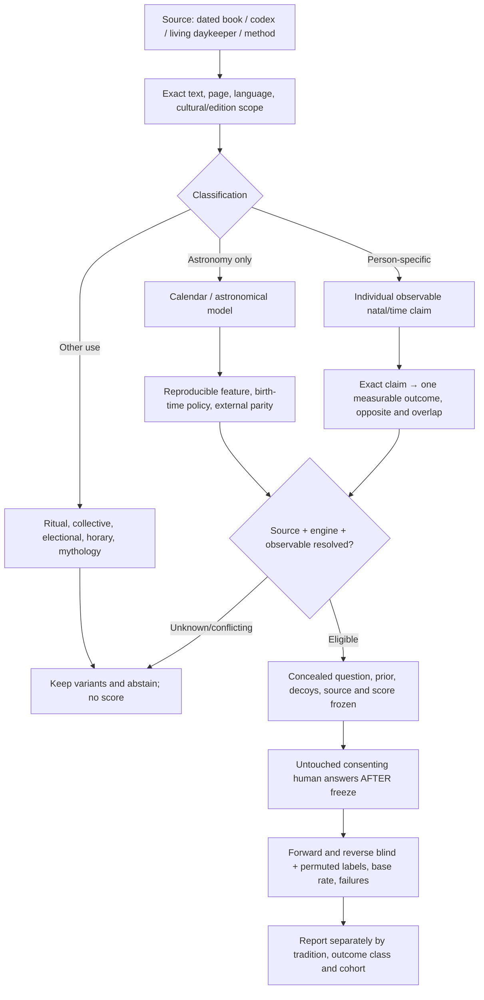
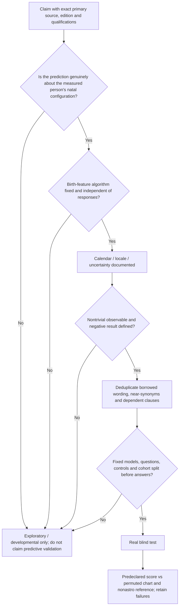

# Living cross-tradition astrology research map
22 October 2026 — **source-controlled research overview; no new validated predictive model**

**Owner outcome:** Find out whether independently calculated birth-derived astrological/HD patterns predict *unseen people's specific responses or future events* better than matched charts, date/control hypotheses and nonastrology baselines, while preserving failed predictions. That empirical outcome remains **OPEN; 0 validated blinded real-human predictions** in the audited tradition tracks.

## Existing map versus missing map

The repository already has a **Human Design-only** [architecture diagram](../../ARCHITECTURE.md), [V2 source-to-behavior mapping protocol](../../reference/core/MAPPING_V2_EVIDENCE_PROTOCOL.md), V4.3 score/reliability policy, questionnaire bank, separate natal/relationship tests, and many *per-tradition* source indexes and domain crosswalks. Those are valuable but **not a single accepted map joining all the schools**. This branch adds that missing *cross-tradition map/index*. It is descriptive, not merged into the production HD scorer and not a replacement for `ARCHITECTURE.md`.

**Canonical map sources:** [overview/workflow](WORKFLOW.mmd), [admission and exclusion gates](SOURCE_TO_TEST_GATES.mmd), [textual lineage links](TRADITION_DEPENDENCIES.mmd), [current 16-family coverage registry](TRADITION_COVERAGE_V1.json), [ranked Maya source catalog](MAYA_SOURCE_CATALOG_V1.json), [Maya source first-read / exploratory claim witnesses](MAYA_FIRST_SOURCE_WITNESS_V1.json), [reading plan](MAYA_READING_AND_RESEARCH_PLAN.md). Each arrow is a *desired verified route* with explicit current status, **not a declaration that every transition is already implemented**.

### Overview — where source reading must actually lead

**Important:** A correct chart from the source's own algorithm is an *engineering* achievement; it does not count as an observation of what a person did. A historical horoscope book's retrospective case study is not an untouched prediction. A Sanskrit → Tibetan or Greek → Arabic → Latin transmission is source lineage, not three independent experiments.

### Interpretation and trial gate — where earlier source-heavy work stalled

External provider and third-party calendar disagreement remains an uncertainty set; different-looking methods must not be chosen after an owner's or participant's chart seems to fit a known story. For Maya, 584283 vs 584285 Gregorian/Long Count correlation, highland vs lowland names, day boundary and numeral 1–13 meaning must remain explicit, not silently collapsed.

## What is already happening, and what is still missing?

| Layer | Actual audited status | Next measurable evidence |
|---|---|---|
| Reading original sources | **Very active** Western, Jyotish, Chinese, Tibetan; new Maya source catalog and one contemporary primary practitioner text read | Preserve original paragraph/page and source independence, not just a large quotation count |
| Source-domain coverage | **Partial and fragmented**: individual tradition indexes and some crosswalks exist | A common claim/construct record across traditions with historical dependencies |
| Astronomical/chart calculations | **Partially tested synthetic**: HD Swiss, Chinese lunar/14-star and BaZi JieQi studies; source/clock variants unresolved | A reproducible chart under fixed declared school and time policy; abstain near conflicts |
| Chart → actual personal observable | **Some HD and Zi Wei candidates**, with overlapping terms, flexible clauses and source-critical gaps | Pick a small nontrivial behavioral question; fix effect direction, confounds and source variants BEFORE exposure to answers |
| Blinded scoring system | **Synthetic engineering tests exist**; these check code and null discrimination, not people | Match actual independently calculated chart/decoys, fix baseline and sample-size denominator |
| Prospective real-human studies | **0** documented confirmatory successes in audited source tracks | Freeze and run an untouched consenting cohort; preserve negative results |
| Maya | **Bibliography plus first-read living daykeeper text; no chart engine or accepted human model** | Anchor 20 day-name/tone math to reference dates and source region, then hold out human answers |
| Nahua, Babylonian, Hellenistic outside Ptolemy, Arabic/Persian | **Missing source-first tracks** | Add original first-source witnesses only if claims materially improve domain coverage or an independent method |

## Mapping individual domains without pretending they are equivalent

Different traditions often mention the same life domain but **different measurable things**. This table is a planning overlay, not a merged scoring matrix:

| Life domain | Source traditions with original claims | What must be disambiguated |
|---|---|---|
| Travel and relocation | Lilly travels; Chinese Zi Wei Travel; Jyotish overseas/migration passages; K'iche' E/Eb' birth-day disposition | **Actual relocation or sea voyage** versus *liking travel/generosity*, fixed age window, opportunity/resources; no common score until aligned |
| Family, siblings, parenthood | Lilly natal siblings/children; Zi Wei Brothers/Children; Jyotish family clauses; Tibetan family passages | Counts, biological/adoptive/step definitions, source conditions, age/time, base rate; untestable original metaphors excluded |
| Marriage and interpersonal patterns | Lilly, Jyotish, Zi Wei Spouses, Tibetan marriage, some Maya birth-day claims | Marriage occurrence/timing vs satisfaction, partner traits vs self-traits, local cultural cohort opportunities |
| Work, character and status | Lilly natal profession; Jyotish yogas; Zi Wei Career; some K'iche' named-day occupations | Prestige/wealth/occupation vs kindness, prudence, stress behavior; cultural opportunity confounds |
| Illness, lifespan, danger | Multiple historical source traditions | **Not eligible for practical recommendations**; exact historical predictions can be studied methodologically but not asserted as medical or safety truth |
| Timing and collective astronomy | Dresden codex, Tibetan almanacs, Chinese electional, Lilly elections, Babylonian omens | Astronomy/ritual/electional **not** automatically personal birth-chart behavior |

### Required claim record

Every proposed scored claim should eventually contain: `tradition_id`, `edition/source_id`, `page/verse`, `exact_limited_quote_or_paraphrase`, `original_vs_commentator`, `prediction_class`, `chart_algorithm_id`, `clock_policy`, `predictor`, `conditions_and_exceptions`, `effect_and_contrary`, `observable_question_ids`, `base_rates`, `source_dependencies`, `confounds`, `eligibility`, `freeze_hash`, `human_cohort_stage`, `outcome_test_record`. Blank fields indicate **UNRESOLVED**, not zero or a fabricated success.

The [K'iche' daykeeper first-read source witness](MAYA_FIRST_SOURCE_WITNESS_V1.json) deliberately contains seven candidate-only claims. None has a frozen Mayan date-conversion engine, independently sourced numerical-tone contribution, calibrated probability, approved exact survey question or untouched outcome. The historic `E/Eb'` association with travel is not equivalent to a personal forecast of emigration.

## Research priorities and maintenance rule

A research project that reads another 10,000 clauses without demonstrating a reproducible source-to-question test will produce a larger library rather than stronger predictive evidence. Continue source reading in parallel, but require the **next map update to answer a direct scientific question**: which new outcome or chart prediction becomes fixed and falsifiable, and which previous ambiguities or duplicates were resolved?

This project map is a *living visual index over independently accepted source branches*; **no source register was merged or promoted by authoring it**. Update the 16-tradition inventory and diagram together only when a material source family/construct/evidence/test stage changes. Never let an attractive diagram overrule the actual source registry, consent/privacy rules or empirical-score freeze. The ongoing **Human Design** `ARCHITECTURE.md` remains canonical for its runtime, scoring and relationship architecture.
