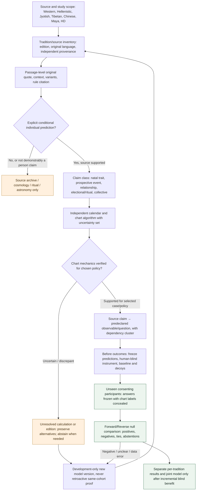
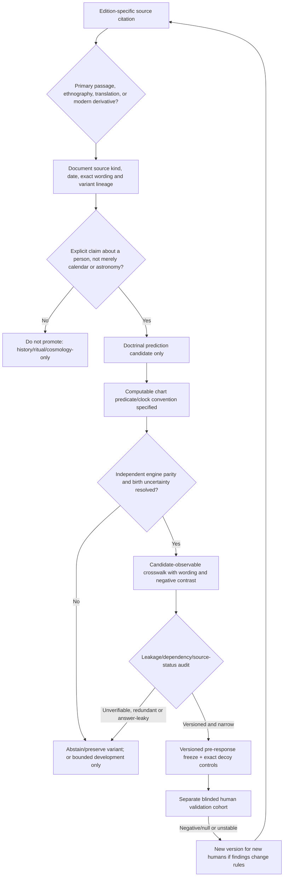
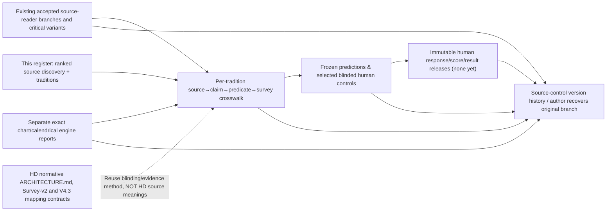
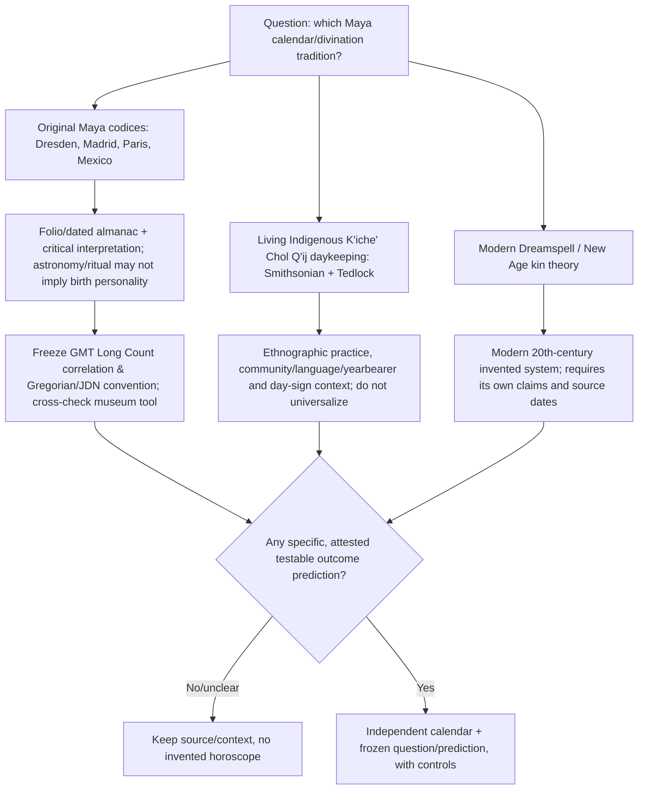

# Cross-tradition astrology source → chart → survey → empirical test map

**Status: research architecture candidate, not deployed or empirically validated.** 2026-10-22. This map is a **source-controlled living index** for this parallel research, not a replacement for the repository's existing normative [Human Design architecture](../../ARCHITECTURE.md) and [mapping evidence protocol](../../reference/core/MAPPING_V2_EVIDENCE_PROTOCOL.md), nor a blanket prerequisite that blocks legitimate exploratory studies.

The owner goal is to compare astrology/divinatory traditions without losing original text, selecting favorable interpretations after outcomes, or assuming that more text annotations translate into greater predictive accuracy. The full **owner empirical outcome is OPEN**; no actual independently blinded human chart→response predictions have been validated. This file illustrates **proposed orchestration** and exact existing accepted artifacts rather than asserting all cross-tradition transitions already execute.

## 1. One-screen workflow overview



The green nodes above describe a **future possible empirical path**, not already achieved readiness. The currently accepted branches mostly populate `INV`, `READ`, and some `CHART` engineering. The `MAP` step exists as a substantial **Human Design-specific** mapping protocol, not as a verified cross-tradition source-to-observable mapping for Maya/Arabic/etc. The real `REAL` and `EVAL` path remains **zero completed studies**.

## 2. Evidence/authority and promotion drill-down



**Human scientific evidence classes must never be pooled:** source text annotations, synthetic within-model recoverability, birth chart engine parity, developmental previously-known biographies, genuine untouched human forward-blind, genuine untouched reverse-blind, relationship-specific out-of-sample results, and collective electional/ritual timing all use separate ledgers, denominators and nulls. Shared language or common planetary names do **not** imply shared effects. Neither `Maya Tzolk'in` nor `Mexica tonalpohualli` is a wholly independent 260-day clock; they are related Mesoamerican systems with distinct interpretations.

## 3. Where truth and ongoing state live



### Canonical pointers (scope-limited)

| Stage / question | Actual authoritative artifact | Current verified reading |
|---|---|---|
| Human Design source/engine/scorer architecture | `ARCHITECTURE.md`, `reference/core/MAPPING_V2_EVIDENCE_PROTOCOL.md`, `docs/20_forward_blind_prospective_validation.md` on repository main | Exists; only covers its declared HD structural features, survey vocabulary and evidence labels |
| Current candidate questionnaire domains | `reference/core/survey_v2_behavioral_domains.json` and `reference/core/survey_v2_field_dependency_map_v1_0_0.json` on main | Six HD-related domains, a declared dependency clustered field map; **not** proof that every Jyotish/Chinese/Maya source construct has a question |
| Western original source lane | `research/astro-b07bh-merchant-friends-source-20261021`, `state/ASTROLOGY_SOURCE_AUDIT_CURRENT.md` | Accepted at that checkpoint: 13,271 Lilly and 1,066 Ptolemy **documentary notes**; later work not assumed complete |
| Indian Vedic/Jyotish five-book reader | `research/astro-jyotish-five-sources-reader-20261020`, B47 handoff | Five academic/translated book sources sampled with 432 **source annotations**; complete critical rule/calculation coverage absent |
| Tibetan calendrical and divination reader | `research/astro-tibetan-t62-henning-originals-planets-20261021`, T62–T67 handoff | 595 Tibetan **source annotations**, original Tibetan historical manuscripts and timing models not exhaustively collated |
| Chinese text and source variants | `research/astro-chinese-v30-bazi-dts24-original-source-20261021`, index V30 | BaZi230 + ZiWei1059 =1289 historical notes. Zi Wei online Volume II 12 palace excerpts surveyed, not original complete work |
| Chinese Four Pillars and solar term computational engineering | accepted separate dual `research/astro-bazi-fourpillars-jieqi-dual-parity-20261021`, Moshier and SWIEPH method branches | Synthetic comparison can return explicit source disagreements and abstain; NOT actual human birth-to-validated-psychometrics |
| Maya primary/ethnographic and calendar work | This `MAYA_RANKED_SOURCE_REGISTER_V1.json` | **Discovery only**: 0 pinned codex passages, 0 actual source-derived personality mappings, 0 verified Maya birth chart calculations |
| Cross-tradition questionnaire gap and source-lineage overlap | `TRADITION_CONSTRUCT_AND_SURVEY_CROSSWALK_V1.json` in this batch | Exploratory map **not yet integrated into HD production scorer**; controls unjustified cross-family mixing |
| Real human forward/reverse validation | Existing `docs/20_forward_blind_prospective_validation.md` protocol | Protocol present; **0 independently validated completed human prediction studies** in the audited ancestry |

## 4. Maya-specific three-way origin separation



`GMT correlation 584283` is a commonly used **candidate Long Count epoch correlation**, not a proved universal daykeeper mapping across all cultural/time/place traditions; calendar-library convention and Gregorian/JDN day offset must be measured independently. Do **not** simply assign modern personal-character lists to historical Dresden astronomical almanacs.

## 5. Source dependencies and survey coverage design

The **most consequential neglected structure is not a missing decorative flowchart**. It is the typed evidence crosswalk:

```text
tradition + original edition + provenance → passage / glyph / context
  → exact conditional claim and its historical subject class
  → natal/time/calendar predicate + algorithm version + uncertainty
  → predeclared observable category and minimally supported question wording
  → dependency/overlap cluster (within and across traditions)
  → control population and negative contrasts
  → source/model/version and prediction freeze BEFORE answers
  → forward-blind decoy/null/permutation evaluation
  → separate result ledger; new version only on NEW humans
```

The existing HD **six** Survey-v2 domains are `V2_PROFILE_ROLE`, `V2_MOON_DRIVE`, `V2_MERCURY_COMMUNICATION`, `V2_VENUS_VALUES`, `V2_CHANNEL_PROCESS`, and `V2_ADAPTIVE_PLANETARY_TIE_BREAKER`. Those are not general astrology schemas; for example an Indian Venus statement is not evidence for the HD Venus Gate domain. A Mayan sacred-day ritual advisory rule is not a trait until the original/living tradition specifically makes that natal claim. A Zi Wei property-palace or Lilly imprisonment/medical rule requires **a separate concrete event history and time window**, never a substitute personality survey item.

`TRADITION_CONSTRUCT_AND_SURVEY_CROSSWALK_V1.json` lists the exact available versus missing/conditional constructs by tradition. It deliberately leaves missing questions **unpromoted**, rather than expanding the existing survey blindly. The later source-coverage audit should cross-check all the astrology constructs, not just what is already asked, and compare domain coverage and real human baseline error rates rather than source note totals.

## 6. Current parent goal / next action

- **Open:** complete missing original texts and calculations only where they can change a prespecified observable hypothesis or correct a source authority/version. Maya calendar lineages are discovery-only.
- **Next most useful:** pin original *Dresden Codex* folio and explain exactly which calendric or predictive glyph table could be transcribed; compare living K’iche’ practice in Tedlock/Smithsonian and keep modern Dreamspell as a separate twentieth-century lineage. Chart arithmetic before any participant's answer.
- **Cross-tradition priority:** Hellenistic practical methods and Arabic/Persian astrological translation lineage before lower-yield new horoscope labels; Nahua separate calendar divination as a related comparator; Babylonian omen/historical precursor; Chinese Qi Men Dun Jia and Thai/Burmese weekday astrology as secondary/exploratory rather than prerequisites.
- **Empirical focus:** the existing HD blind-test protocol and toy synthetic scorer are reusable, but the cross-tradition source→observable rule table and actual untouched human scored experiment are still absent. The map is not a new fail-closed owner requirement; it documents those gaps.

**Human genuine blinded astrology predictive validations: zero. Astrology rules promoted into runtime by this map: zero.**
